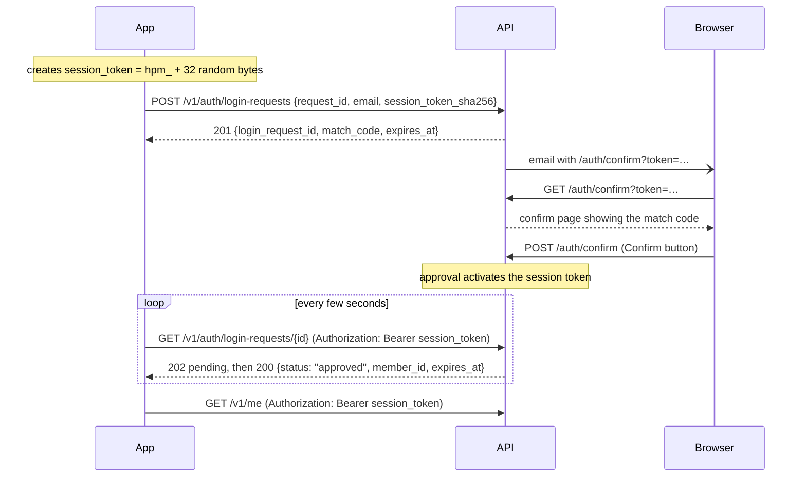

# api

Homeport's control plane: a Cloudflare Worker (TypeScript, [Hono](https://hono.dev)) with a D1 database.

So far it covers email magic-link sign-in, sessions, `request_id` idempotency, the credits ledger, the Stripe Identity check, buying credits through Stripe Checkout, sharing devices, lines and WireGuard peers, and the endpoints edge gateways call: config, quota leases, usage and line events.

## Requirements

- Node.js 26 (`.nvmrc`)
- npm (the lockfile is `package-lock.json`)

Wrangler is a dev dependency, so no global install is needed.

## Develop

```bash
npm ci
cp .dev.vars.example .dev.vars
npm run migrate:local
npm run dev
```

`.dev.vars` sets `ENVIRONMENT=dev` and `EMAIL_MODE=log`, so sign-in links are written to the `wrangler dev` log instead of being emailed.

| Script | What it does |
| --- | --- |
| `npm run dev` | `wrangler dev` with a local D1 database |
| `npm test` | Vitest inside the Workers runtime (`@cloudflare/vitest-plugin`); migrations are applied in `test/apply-migrations.ts`, and responses are checked against the contract (see below) |
| `npm run lint` | ESLint with type-aware rules, including `no-floating-promises` |
| `npm run typecheck` | `tsc` for `src/` and `test/` |
| `npm run types` | Regenerates `worker-configuration.d.ts` after a change to `wrangler.jsonc`; CI fails if it is stale |
| `npm run migrate:local` | Applies `migrations/` to the local D1 database |
| `npm run seed:dev` | Applies the migrations locally, adds a dev gateway to the local database and prints its token (`HOMEPORT_GATEWAY_TOKEN=hpgw_...`) for the gateway binary. `npm run seed:dev -- --persist-to <dir>` seeds the database a `wrangler dev --persist-to <dir>` uses instead, as the full-stack smoke test in `e2e/` does |

## Configuration

| Name | Values | Default in `wrangler.jsonc` |
| --- | --- | --- |
| `ENVIRONMENT` | `dev` enables the `/dev` routes and email log mode; anything else is production | `production` |
| `EMAIL_MODE` | `log` writes sign-in links to the log, and works only when `ENVIRONMENT=dev`. Real delivery comes in a later PR; until then, other values return `503 email_unavailable` | `disabled` |
| `PUBLIC_BASE_URL` | Origin used to build the links in sign-in emails and Checkout's return pages, and the first top-up host. Without a valid http(s) URL no link is sent (`503 email_unavailable`) and no Checkout Session is created (500) | empty |
| `TOPUP_HOSTNAMES` | Comma-separated hosts a peer without credits can still reach through the gateway, besides the API's own host. They must not offer ECH (on Cloudflare, turn it off for those zones), since the gateway reads the clear SNI | Stripe Checkout's hosts |
| `DB` | D1 database `homeport`, migrations in `migrations/` | |
| `STRIPE_SECRET_KEY` | Secret. Creates Identity verification sessions and Checkout Sessions. Prefer a restricted key (`rk_`) with Checkout Sessions: Write and Identity Verification Results: Write, as the Dashboard names them | |
| `STRIPE_IDENTITY_RESTRICTED_KEY` | Secret. Restricted key (`rk_`) with Identity Verification Results: Read and Recent Detailed Verification Results: Read; reads document number and birth date for the identity hash. Only live-mode verifications read it, so a sandbox can leave it empty | |
| `STRIPE_WEBHOOK_SECRET` | Secret. Signing secret of the webhook endpoint (`whsec_`), or the one `stripe listen` prints | |
| `IDENTITY_HASH_KEY` | Secret. HMAC key of the identity hash. Changing it breaks the duplicate check for members verified before | |

Secrets are listed in `wrangler.jsonc` (`secrets.required`), set with `wrangler secret put`, and locally in `.dev.vars` (see `.dev.vars.example`; use a Stripe sandbox's test keys).

## Sign-in

The desktop app signs in by polling, so it needs no custom URL scheme. The endpoints follow the contract in `contracts/control-api.openapi.yaml` (operations `createLoginRequest`, `getLoginRequest`, `deleteSession` and `getMe`; added in jermainee/homeport#7).



1. The app creates its session token, `hpm_` plus 32 random bytes in base64url, and keeps it.
2. `POST /v1/auth/login-requests` takes `{request_id, email, session_token_sha256}`. It returns `{login_request_id, match_code, expires_at}` and sends the link. The response is the same whether or not the email belongs to a member. The app shows the match code.
3. Opening the link shows a confirm page with the same match code. Opening it changes nothing, so mail scanners that prefetch links cannot sign anyone in. The member checks that the codes agree and clicks Confirm. The form posts the code back, and the API approves only if it agrees with the request's code. Approval creates the member on first sign-in and activates the app's session token.
4. `GET /v1/auth/login-requests/{id}` with `Authorization: Bearer <session_token>` polls the sign-in. The token works here before approval and nowhere else. A poll only reads, so it carries no `request_id`, and every response has `Cache-Control: no-store`. Responses:
   - `202 {status: "pending"}` until the member approves;
   - `200 {status: "approved", member_id, expires_at}` on every poll after that, until the request expires (`expires_at` is when the session token stops working);
   - `401 unauthorized` for a missing or malformed token;
   - `404 not_found` for a token that belongs to another request;
   - `410 login_request_expired` once the request has expired.
5. `GET /v1/me` with `Authorization: Bearer <session_token>` returns `{member_id, email, identity_status, credits}`, or `401` without a live session. `credits` are the member's ledger balances (see Credits ledger).
6. `DELETE /v1/auth/session` revokes the session it is called with: `204`, or `401`.

No response carries a secret, so replaying one by `request_id` is harmless.

### `request_id`

Every POST under `/v1`, except Stripe's webhook, carries a `request_id`, a UUIDv7 the client creates once and reuses on retries (`src/idempotency.ts`).

- A retry with the same `request_id` and body gets the first response again, status and body.
- The same `request_id` with another body, on another endpoint, or from another signed-in member, gets `409 idempotency_conflict`. Behind a session the member is part of the request, so no member sees another member's response (such as a Stripe verification URL). Member endpoints use `memberIdempotent`, which runs `requireSession` before `idempotent`.
- A `request_id` older than 24 hours gets `400 request_id_expired`. One more than 1 hour in the future gets `400 invalid_request`.
- While the first request is still running, a retry gets `429 rate_limited` with `Retry-After: 1`. A first request that stays silent for a minute (an evicted isolate, a cancelled request) is taken over by the next retry.
- 5xx responses are not kept, so a retry runs again.
- Records live 25 hours. Only a SHA-256 fingerprint of method, path, member and body is stored, never the body.

### Rules the code enforces

- The API stores the session token and the link token only as SHA-256 hashes. A session token can start only one login request.
- A link is single-use and expires 15 minutes after the request, together with the request.
- Once approved, a request answers polls for at least 5 more minutes, so an approval just before expiry still reaches the app.
- Sessions last 90 days from approval.
- The match code is a six-digit number. It is not a secret, so it is stored as is.
- Request schemas are closed: an unknown field gets `400 invalid_request`. Errors are `{error, message?}`.
- Request bodies over the route's limit get `413 payload_too_large`: 16 KB by default, 128 KB for the gateway batch endpoints, as each operation's `x-max-body-bytes` in the contract says, and 256 KB for Stripe's webhook (`src/body-limits.ts`).
- Logs and traces drop query strings (`observability.redact_query_string`), so link tokens never reach them.

## Credits ledger

All prices, billing constants and product limits live in `src/pricing.ts`; no other file holds a price. The ledger is in `src/ledger/`.

- **Double-entry, append-only.** Every booking is a `ledger_transactions` row with at least two `ledger_entries` (signed whole credits) that sum to zero. Triggers abort every `UPDATE` and `DELETE` of either table, so a correction is a new, reversing transaction. Each booking ends by inserting its id into the `ledger_balance_checks` view, whose trigger aborts the whole batch if the entries do not balance.
- **Accounts.** Each member has `purchased`, `earned_pending` and `earned_cashable`, created by a trigger when the member is created. The platform has `platform_revenue`, `credits_issued` (the source of sold credits) and `dev_grants`. Each account caches its balance, which a trigger moves with every entry.
- **Idempotent.** Each transaction has a unique `idempotency_key` naming the business event (`usage:<usage_key>`, `dev_grant:<id>`, ...). A retry finds it and books nothing.
- **One guarded batch per change.** D1 has no interactive transactions. A change reads the `ledger_version` of every member whose balance it changes, with the balances it decides on, then writes everything in one `db.batch`. The batch's first statement bumps those versions, guarded by the values read, and sets a fresh `ledger_nonce`; every later statement runs only while that nonce is still there for every claimed member. If another change committed first, the batch writes nothing and the change reads again and retries (`src/ledger/guarded-batch.ts`). A usage charge claims both the user and the line's owner, because the owner's own spend splits its debit by the balances it read.
- **Spend order.** Usage takes `purchased` first, then `earned_pending`, then `earned_cashable`. Metered usage is always booked, even past the balance; the shortfall makes `purchased` negative. `GET /v1/me` shows a negative account as 0.
- **Usage charges.** `chargeUsage` adds bytes to a meter's running total (`meter_totals`, for example per WireGuard peer). The user pays `floor(total × 10 / 10^6)` minus what the meter already charged, and the line's owner earns `floor(total × 5 / 10^6)` minus what it already paid into `earned_pending`; the platform keeps the difference. Rounding therefore never adds up across usage events. Each piece of usage is recorded once in `usage_charges` by its `usage_key`, even when it books less than a credit. A meter never changes payer or payee (a trigger aborts it). `usage_charges` rows are not ledger rows: the hourly cleanup deletes them after 7 days, when a retry of their usage is rejected as expired anyway.
- **Reservations.** A quota lease reserves credits (`credit_reservations`) without booking anything: available credits are the balance minus what open, unexpired reservations still hold. Usage charged against a reservation reduces what it holds, and releasing it frees the rest. The check and the insert run behind the member's guard, so concurrent leases never reserve more than the member has. Reserving an id again returns `reserved` and holds nothing more.
- **Sold credits stay purchased.** `grantCredits` with source `credits_issued` lands only in `purchased`, so bought credits can never become cashable.

## Contract checks in tests

`vitest.config.ts` loads `@homeport/contracts` (`file:../contracts`, installed as a copy through `install-links=true` in `.npmrc`) in Node and exposes it to tests as the `CONTRACT` service binding, because ajv cannot compile schemas inside workerd. `expectContract(method, pathTemplate, response)` in `test/contract.ts` checks a response's status and body against `contracts/control-api.openapi.yaml`. Run `npm install` again after the contract changes.

## Identity check (Stripe Identity)

Every member passes Stripe Identity (ID document and live selfie) before Share or Use turns on.

1. `POST /v1/identity/sessions` (Bearer, `{request_id}`) creates a VerificationSession (`type: document`, `require_matching_selfie`, `require_live_capture`, `metadata.member_id`) and answers `201 {url}`, the Stripe-hosted page the app opens. A verified member gets `409 identity_already_verified`, and a member who started 5 checks in the last 24 hours gets `429 rate_limited` with `Retry-After` (Stripe bills each submitted check). The Stripe idempotency key is `identity_session:<request_id>`.
2. Stripe calls `POST /v1/stripe/webhook`. The handler checks the `Stripe-Signature` header on the raw body (`Stripe.webhooks.constructEventAsync` with the SubtleCrypto provider; 400 `invalid_signature` otherwise), skips an event id it already handled (`stripe_events`), and answers 200. A failure answers 500, so Stripe delivers the event again.
3. Events change `members.identity_status` only for sessions Homeport created for that member (`identity_sessions`):
   - `verified`: verifies the member. It always applies, since verification is final.
   - `processing`: `processing`. `requires_input` and `canceled`: `requires_input`. These apply only while the member is not verified, only for the member's newest check (an abandoned check that ends later says nothing about the current one), and only if no newer event was applied (Stripe does not keep order).
4. **One person, one account.** In the `verified` handler, inside Stripe's 48-hour window, the restricted key reads the document number, issuing country and birth date. Their HMAC (`IDENTITY_HASH_KEY`) is stored as `members.identity_hash`, which is unique. A member whose hash another member already has stays at `requires_input` (`identity_failure = 'duplicate_identity'`), as does a live-mode document without those fields. Test mode (`livemode: false`) skips the hash and the check, since every test document is the same, and reads nothing sensitive. Document numbers are compared after Unicode NFKC normalization, without case, spaces or punctuation; letters and digits of every script count. Only the result and the hash are stored; the document data stays with Stripe.
5. `requireVerifiedIdentity` (`src/identity/require-verified.ts`) answers `403 identity_required` until the member is verified. Lines, the available list, new WireGuard peers and credit purchases sit behind it; `verifiedMemberIdempotent` (`src/idempotency.ts`) runs it before `idempotent`, so a 403 is not stored for the `request_id`.

Locally, `stripe listen --print-secret` prints the signing secret for `.dev.vars`, and `stripe listen --forward-to localhost:8787/v1/stripe/webhook --events …` forwards the Identity and Checkout events. Current Stripe CLI versions refuse to listen without `--events`; [the manual run](../e2e/README.md#1-api-and-stripe) has the full command.

Tests replace Stripe's API with a fake port (`test/fake-stripe.ts`, injected through `createApp` in `src/app.ts`) and sign webhook bodies with HMAC-SHA256 like Stripe does. `test/stripe-identity-api.spec.ts` and `test/stripe-checkout-api.spec.ts` check the real adapters' requests with a recording `fetch`.

## Buying credits (Stripe Checkout)

A verified member buys one credit pack at a time: 1,000,000 credits for €40 net (`src/pricing.ts`). Stripe Tax adds the tax for the buyer's location on top.

**Stripe Tax setup.** Each Stripe account or sandbox needs this setup in its own Tax settings:
- **Head office:** without it, the tax settings stay `pending` and Stripe refuses to create Checkout Sessions with `automatic_tax`.
- **Registrations:** a registration for every jurisdiction where tax is collected. Without one, Stripe collects 0 tax there and reports no error.

Check both in the Dashboard under Tax, or with the Tax Settings and Tax Registrations APIs, before members buy. Business buyers are treated as consumers, because tax IDs are not collected yet.

1. `POST /v1/checkout/sessions` (Bearer, `{request_id}`, verified identity) creates a hosted Checkout Session (`src/stripe/checkout-api.ts`): `mode: payment`, one line item with inline `price_data` (`unit_amount` 4,000 EUR cents, `tax_behavior: exclusive`, product `tax_code` `CREDIT_PACK_TAX_CODE`), `automatic_tax: {enabled: true}`, `client_reference_id` and `metadata {member_id, pack}` on the session and its PaymentIntent, no `payment_method_types` (the Dashboard picks the methods), and return pages `/checkout/done` and `/checkout/canceled` on `PUBLIC_BASE_URL`. It answers `201 {url}`, the page the app opens. The Stripe idempotency key is `checkout_session:<request_id>`. An unverified member gets `403 identity_required`, and a member who opened 10 sessions in the last hour gets `429 rate_limited` with `Retry-After`, since every session calls Stripe, whose rate limit all members share.
2. The same call writes a `payments` row (status `open`) that fixes what the session grants: pack, credits, net cents and currency.
3. The webhook grants the credits, never the return page:
   - `checkout.session.completed` with `payment_status: paid`, and `checkout.session.async_payment_succeeded`, book `credits_issued` → the member's `purchased` with idempotency key `purchase:<session id>`, and mark the payment `paid`, with the total and the tax Stripe collected (`amount_total_cents`, `amount_tax_cents`), in the same guarded batch (`grantCredits`' `alsoWrite`). A session never grants twice, whichever events arrive and however often.
   - `checkout.session.completed` with `payment_status: unpaid` (a delayed payment method such as SEPA Direct Debit) marks it `processing`. `no_payment_required` changes nothing, since every pack has a price.
   - `checkout.session.async_payment_failed` and `checkout.session.expired` mark an unpaid payment `failed` or `expired`; a paid one stays paid.
   - Events of sessions Homeport did not create for that member change nothing, and the credits come from the `payments` row, not from the event.

The webhook endpoint in the Stripe Dashboard needs these four events next to the Identity events. Refunds and disputes are not handled yet.

## Sharing and using lines

All endpoints follow the contract (`registerDevice`, `createLine`, `updateLine`, `listAvailableLines`, `createWireguardPeer`, `listWireguardPeers`, `deleteWireguardPeer`).

- **Devices.** `POST /v1/devices` stores a sharing agent's raw Ed25519 key and returns `spki_sha256`, the SHA-256 of its SubjectPublicKeyInfo (DER), which the gateway checks during mutual TLS. Registering a key again returns the same device with 200; a key another member registered gets `409 agent_key_taken`. A member can register 10 new devices a day; more get `429 rate_limited` with `Retry-After`. Devices need no identity check, as the contract has none for them: the app registers its key when it is installed.
- **Lines.** `POST /v1/lines {device_id}` creates the device's line on the newest gateway and returns where the agent dials out to; a device has one line (a second call returns it with 200). Its country, city and ISP come from Cloudflare's view of that request (`request.cf`), since the device is at home then; line tests will replace them. A line starts with sharing off; `PATCH /v1/lines/{id} {sharing_enabled}` switches it.
- **Available lines.** `GET /v1/lines/available` lists sharing lines with a known country, minus the member's own lines, lines of linked members, lines of suspended owners and full lines.
- **WireGuard peers.** The client creates the device's X25519 key pair and sends only the public key, so the API never sees a private key; `config_text` holds `{{PRIVATE_KEY}}` where the client puts it. Each peer gets one host number used in both tunnel networks: `10.77.a.b` (host = a × 256 + b, from 2 to 65534; `10.77.0.1` is the gateway) and `fd77::<host in hex>` in `fd77::/64`. One atomic insert takes the lowest free number. The config sets `DNS = 10.77.0.1`, `MTU = 1280`, `AllowedIPs = 0.0.0.0/0, ::/0`, `PersistentKeepalive = 25` and the line's gateway as `Endpoint` and `PublicKey`. A key in use by another peer gets `409 public_key_taken`. A member can have 20 active peers (`MAX_PEERS_PER_MEMBER` in `src/pricing.ts`), so no account can use up the shared address pool; the 21st gets `429 rate_limited` until one is deleted. Names count characters (code points), as the contract does. Deleting a peer keeps its row (`deleted_at`), so late usage still finds its member, and frees its key and address.
- **No self-dealing.** A member never uses their own line, or a line whose owner is linked to them: a `member_links` row in either direction (household, device, card, Connect account), or sessions from the same app install (`auth_sessions.install_id`). Such a line is missing from the available list, and a peer for it gets `403 line_not_allowed`.
- **Shared lines** serve at most 3 members besides their owner (`MAX_USERS_PER_LINE` in `src/pricing.ts`); a fourth gets `409 line_full`, while a member already on the line can add devices.
- **Identity.** Lines, the available list and new peers answer `403 identity_required` until the member passed Stripe Identity (`src/identity/require-verified.ts`). The check runs before `request_id` handling, so a 403 is not stored for a `request_id`. Listing and deleting one's own peers work without it.

## Gateway endpoints

Edge gateways (`gateway/`) call `/v1/gateway/*` (contract tag `gateway`, `src/gateway/`). The gateway never sees a price: it counts bytes, and `src/pricing.ts` turns them into credits.

- **Token.** `Authorization: Bearer hpgw_<gatewayId>.<secret>`, the secret 32 random bytes in base64url. `gateway_credentials` stores only the secret's SHA-256, compared in constant time; a credential can be revoked (`revoked_at`). Member session tokens get `401` here, and gateway tokens get `401` everywhere else. Provisioning is `npm run seed:dev` locally; production provisioning comes with the deploy.
- **`PUT /v1/gateway/self`** stores the gateway's endpoints and keys under the token's gateway id (`204`). New lines go to the gateway that announced itself last.
- **`GET /v1/gateway/config`** lists the gateway's lines whose sharing is on and whose owner is active and verified, with the agent's SPKI pin (`device_spki_sha256`, lowercase hex), and the peers it may accept on them: not deleted, member active and verified, and no self-dealing (`ownerIsLinkedSql`). `topup_hostnames` is the API's own host, then `TOPUP_HOSTNAMES`. The body's `etag` hashes the rest; `If-None-Match` with it, weak or strong, gets `304`.
- **`POST /v1/gateway/leases`** reserves credits for a peer's session and grants what they buy: 2,000 credits = 200,000,000 bytes, renewed at 160,000,000, for an hour, with 300 grace seconds. A member with fewer credits gets a smaller last lease; one with none gets `402 insufficient_credits` with `grace_seconds`. A peer the config would not list gets `403 peer_inactive`. A renewal names `supersedes_lease_id`; a lease is superseded once (a unique index), and renewing it again returns that successor with `200`. A lease the gateway never got is `404`, one from another session `400`. The reservation and the lease row commit in one guarded batch.
- **`POST /v1/gateway/leases/{id}/return`** releases what the lease still holds (`released_credits`); a lease returned before or expired releases `0`.
- **`POST /v1/gateway/usage`** applies up to 100 events in order, each once by `event_id`: `applied`, `duplicate` (the same event again) or `rejected` with `unknown_peer`, `unknown_line`, `unknown_lease`, `lease_mismatch` (another session's, peer's or line's lease), `seq_conflict` (a gap, a repeat, after the final event, or an `event_id` reused for other bytes), `invalid_period` (not starting where the last period ended, or ending before it starts) or `expired` (an `event_id` over 72 hours old). An applied event is charged to the peer's meter with `chargeUsage`, against its lease; the event and the session log are written in the same guarded batch. Usage past a lease's bytes, after it expired, or of a peer deleted since is still charged: the gateway is the meter of record. A body that breaks the contract (an unknown field, such as a destination) gets `400` for the whole batch.
- **Session log.** `usage_sessions` holds, per session: member, line, owner, the line's exit IP at the start, start, end, bytes up and down. Nothing about destinations or content is ever received or stored.
- **`POST /v1/gateway/line-events`** marks the gateway's lines online or offline, each event once; an event older than the line's newest applied one changes nothing.
- **Cleanup.** An hourly cron (`src/prune.ts`) deletes `usage_events`, `line_events` and `usage_charges` 7 days after they arrived, and expired `idempotency_records`. The ledger, `meter_totals`, `leases` and `usage_sessions` stay.

## Dev-only routes

Routes under `/dev` answer `404` unless `ENVIRONMENT` is exactly `dev`.

- `POST /dev/login-requests/{id}/confirm` with `{session_token}` approves a login request without the email link, so automated tests can sign in.
- `POST /dev/members/{member_id}/identity/verify` marks the member's identity verified, as Stripe Identity's `verified` webhook does in test mode, and returns `{identity_status: "verified"}`, so local runs and end-to-end tests can share and use lines without an Identity check.
- `POST /dev/members/{member_id}/credits` with `{credits}` grants purchased credits from the `dev_grants` account and returns `{credits}`, so local runs and end-to-end tests can use lines without a Checkout payment.
- `PUT /dev/gateways/{id}` with the contract's `GatewaySelf` body stores a gateway under any id without a token, for tests. A real gateway sends `PUT /v1/gateway/self` with the token from `npm run seed:dev`.

## Database

- `migrations/0001_magic_link_auth.sql` creates `members`, `login_requests`, `magic_link_tokens`, `auth_sessions` and `idempotency_records`.
- `migrations/0002_credit_ledger.sql` adds `members.ledger_version` and `members.ledger_nonce`, and creates `ledger_accounts`, `ledger_transactions`, `ledger_entries`, the `ledger_balance_checks` view, `meter_totals`, `usage_charges` and `credit_reservations`, with their triggers.
- `migrations/0003_stripe_identity.sql` adds `members.identity_hash` (unique), `identity_failure` and `identity_event_created`, and creates `identity_sessions` and `stripe_events`.
- `migrations/0004_lines_and_peers.sql` creates `gateways`, `devices`, `lines`, `wireguard_peers` and `member_links`, and indexes `auth_sessions.install_id`.
- `migrations/0005_credit_checkout.sql` creates `payments`, one row per Checkout Session.
- `migrations/0006_gateway_billing.sql` creates `gateway_credentials`, `leases`, `usage_sessions`, `usage_events` and `line_events`, and adds `lines.online_changed_at`.

Timestamps are Unix epoch milliseconds. Schema changes ship as new numbered migration files; the deploy workflow (a later PR) applies them.
