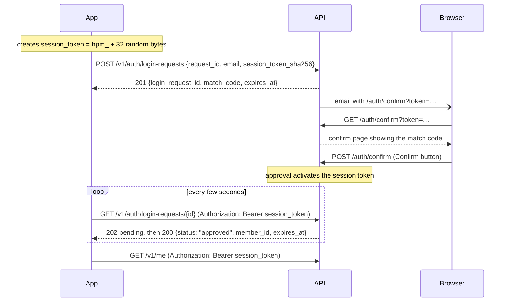

# api

Homeport's control plane: a Cloudflare Worker (TypeScript, [Hono](https://hono.dev)) with a D1 database.

So far it covers email magic-link sign-in, sessions, `request_id` idempotency and the credits ledger. Later PRs add Stripe Identity, Checkout, lines, WireGuard peers and the gateway endpoints.

## Requirements

- Node.js 26 (`.nvmrc`)
- npm (the lockfile is `package-lock.json`)

Wrangler is a dev dependency, so no global install is needed.

## Develop

```bash
npm ci
cp .dev.vars.example .dev.vars
npm run migrate:local
npm run dev
```

`.dev.vars` sets `ENVIRONMENT=dev` and `EMAIL_MODE=log`, so sign-in links are written to the `wrangler dev` log instead of being emailed.

| Script | What it does |
| --- | --- |
| `npm run dev` | `wrangler dev` with a local D1 database |
| `npm test` | Vitest inside the Workers runtime (`@cloudflare/vitest-plugin`); migrations are applied in `test/apply-migrations.ts`, and responses are checked against the contract (see below) |
| `npm run lint` | ESLint with type-aware rules, including `no-floating-promises` |
| `npm run typecheck` | `tsc` for `src/` and `test/` |
| `npm run types` | Regenerates `worker-configuration.d.ts` after a change to `wrangler.jsonc`; CI fails if it is stale |
| `npm run migrate:local` | Applies `migrations/` to the local D1 database |

## Configuration

| Name | Values | Default in `wrangler.jsonc` |
| --- | --- | --- |
| `ENVIRONMENT` | `dev` enables the `/dev` routes and email log mode; anything else is production | `production` |
| `EMAIL_MODE` | `log` writes sign-in links to the log, and works only when `ENVIRONMENT=dev`. Real delivery comes in a later PR; until then, other values return `503 email_unavailable` | `disabled` |
| `PUBLIC_BASE_URL` | Origin used to build the links in sign-in emails. Without a valid http(s) URL no link is sent (`503 email_unavailable`) | empty |
| `DB` | D1 database `homeport`, migrations in `migrations/` | |

## Sign-in

The desktop app signs in by polling, so it needs no custom URL scheme. The endpoints follow the contract in `contracts/control-api.openapi.yaml` (operations `createLoginRequest`, `getLoginRequest`, `deleteSession` and `getMe`; added in jermainee/homeport#7).



1. The app creates its session token, `hpm_` plus 32 random bytes in base64url, and keeps it.
2. `POST /v1/auth/login-requests` takes `{request_id, email, session_token_sha256}`. It returns `{login_request_id, match_code, expires_at}` and sends the link. The response is the same whether or not the email belongs to a member. The app shows the match code.
3. Opening the link shows a confirm page with the same match code. Opening it changes nothing, so mail scanners that prefetch links cannot sign anyone in. The member checks that the codes agree and clicks Confirm. The form posts the code back, and the API approves only if it agrees with the request's code. Approval creates the member on first sign-in and activates the app's session token.
4. `GET /v1/auth/login-requests/{id}` with `Authorization: Bearer <session_token>` polls the sign-in. The token works here before approval and nowhere else. A poll only reads, so it carries no `request_id`, and every response has `Cache-Control: no-store`. Responses:
   - `202 {status: "pending"}` until the member approves;
   - `200 {status: "approved", member_id, expires_at}` on every poll after that, until the request expires (`expires_at` is when the session token stops working);
   - `401 unauthorized` for a missing or malformed token;
   - `404 not_found` for a token that belongs to another request;
   - `410 login_request_expired` once the request has expired.
5. `GET /v1/me` with `Authorization: Bearer <session_token>` returns `{member_id, email, identity_status, credits}`, or `401` without a live session. `credits` are the member's ledger balances (see Credits ledger).
6. `DELETE /v1/auth/session` revokes the session it is called with: `204`, or `401`.

No response carries a secret, so replaying one by `request_id` is harmless.

### `request_id`

Every POST under `/v1` carries a `request_id`, a UUIDv7 the client creates once and reuses on retries (`src/idempotency.ts`).

- A retry with the same `request_id` and body gets the first response again, status and body.
- The same `request_id` with another body, or on another endpoint, gets `409 idempotency_conflict`.
- A `request_id` older than 24 hours gets `400 request_id_expired`. One more than 1 hour in the future gets `400 invalid_request`.
- While the first request is still running, a retry gets `429 rate_limited` with `Retry-After: 1`. A first request that stays silent for a minute (an evicted isolate, a cancelled request) is taken over by the next retry.
- 5xx responses are not kept, so a retry runs again.
- Records live 25 hours. Only a SHA-256 fingerprint of method, path and body is stored, never the body.

### Rules the code enforces

- The API stores the session token and the link token only as SHA-256 hashes. A session token can start only one login request.
- A link is single-use and expires 15 minutes after the request, together with the request.
- Once approved, a request answers polls for at least 5 more minutes, so an approval just before expiry still reaches the app.
- Sessions last 90 days from approval.
- The match code is a six-digit number. It is not a secret, so it is stored as is.
- Request schemas are closed: an unknown field gets `400 invalid_request`. Errors are `{error, message?}`.
- Request bodies over the route's limit get `413 payload_too_large`: 16 KB by default, 128 KB for the gateway batch endpoints, as each operation's `x-max-body-bytes` in the contract says (`src/body-limits.ts`).
- Logs and traces drop query strings (`observability.redact_query_string`), so link tokens never reach them.

## Credits ledger

All prices and billing constants live in `src/pricing.ts`; no other file holds a price. The ledger is in `src/ledger/`.

- **Double-entry, append-only.** Every booking is a `ledger_transactions` row with at least two `ledger_entries` (signed whole credits) that sum to zero. Triggers abort every `UPDATE` and `DELETE` of either table, so a correction is a new, reversing transaction. Each booking ends by inserting its id into the `ledger_balance_checks` view, whose trigger aborts the whole batch if the entries do not balance.
- **Accounts.** Each member has `purchased`, `earned_pending` and `earned_cashable`, created by a trigger when the member is created. The platform has `platform_revenue`, `credits_issued` (the source of sold credits) and `dev_grants`. Each account caches its balance, which a trigger moves with every entry.
- **Idempotent.** Each transaction has a unique `idempotency_key` naming the business event (`usage:<usage_key>`, `dev_grant:<id>`, ...). A retry finds it and books nothing.
- **One guarded batch per change.** D1 has no interactive transactions. A change reads the member's `ledger_version` with the balances it decides on, then writes everything in one `db.batch`. The batch's first statement bumps the version, guarded by the value read, and sets a fresh `ledger_nonce`; every later statement runs only while that nonce is still there. If another change committed first, the batch writes nothing and the change reads again and retries (`src/ledger/guarded-batch.ts`).
- **Spend order.** Usage takes `purchased` first, then `earned_pending`, then `earned_cashable`. Metered usage is always booked, even past the balance; the shortfall makes `purchased` negative. `GET /v1/me` shows a negative account as 0.
- **Usage charges.** `chargeUsage` adds bytes to a meter's running total (`meter_totals`, for example per WireGuard peer). The user pays `floor(total × 10 / 10^6)` minus what the meter already charged, and the line's owner earns `floor(total × 5 / 10^6)` minus what it already paid into `earned_pending`; the platform keeps the difference. Rounding therefore never adds up across usage events. Each piece of usage is recorded once in `usage_charges` by its `usage_key`, even when it books less than a credit.
- **Reservations.** A quota lease reserves credits (`credit_reservations`) without booking anything: available credits are the balance minus what open, unexpired reservations still hold. Usage charged against a reservation reduces what it holds, and releasing it frees the rest. The check and the insert run behind the member's guard, so concurrent leases never reserve more than the member has.

## Contract checks in tests

`vitest.config.ts` loads `@homeport/contracts` (`file:../contracts`, installed as a copy through `install-links=true` in `.npmrc`) in Node and exposes it to tests as the `CONTRACT` service binding, because ajv cannot compile schemas inside workerd. `expectContract(method, pathTemplate, response)` in `test/contract.ts` checks a response's status and body against `contracts/control-api.openapi.yaml`. Run `npm install` again after the contract changes.

## Dev-only routes

Routes under `/dev` answer `404` unless `ENVIRONMENT` is exactly `dev`.

- `POST /dev/login-requests/{id}/confirm` with `{session_token}` approves a login request without the email link, so automated tests can sign in.
- `POST /dev/members/{member_id}/credits` with `{credits}` grants purchased credits from the `dev_grants` account and returns `{credits}`, so local runs and end-to-end tests can use lines before credit packs can be bought.

## Database

- `migrations/0001_magic_link_auth.sql` creates `members`, `login_requests`, `magic_link_tokens`, `auth_sessions` and `idempotency_records`.
- `migrations/0002_credit_ledger.sql` adds `members.ledger_version` and `members.ledger_nonce`, and creates `ledger_accounts`, `ledger_transactions`, `ledger_entries`, the `ledger_balance_checks` view, `meter_totals`, `usage_charges` and `credit_reservations`, with their triggers.

Timestamps are Unix epoch milliseconds. Schema changes ship as new numbered migration files; the deploy workflow (a later PR) applies them.
