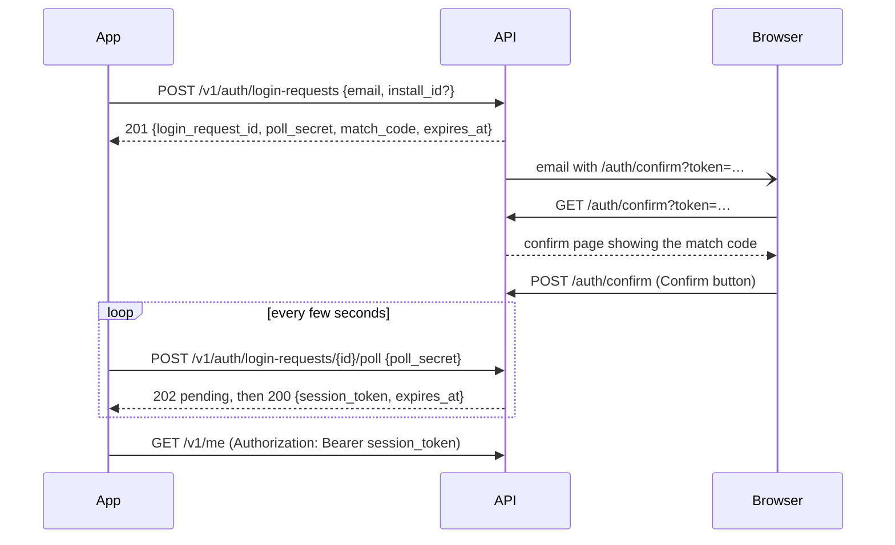

# api

Homeport's control plane: a Cloudflare Worker (TypeScript, [Hono](https://hono.dev)) with a D1 database.

So far it covers email magic-link sign-in and sessions. Later PRs add the credits ledger, Stripe Identity, Checkout, lines and WireGuard peers.

## Requirements

- Node.js 26 (`.nvmrc`)
- npm (the lockfile is `package-lock.json`)

Wrangler is a dev dependency, so no global install is needed.

## Develop

```bash
npm ci
cp .dev.vars.example .dev.vars
npm run migrate:local
npm run dev
```

`.dev.vars` sets `ENVIRONMENT=dev` and `EMAIL_MODE=log`, so sign-in links are written to the `wrangler dev` log instead of being emailed.

| Script | What it does |
| --- | --- |
| `npm run dev` | `wrangler dev` with a local D1 database |
| `npm test` | Vitest inside the Workers runtime (`@cloudflare/vitest-plugin`); migrations are applied in `test/apply-migrations.ts` |
| `npm run lint` | ESLint with type-aware rules, including `no-floating-promises` |
| `npm run typecheck` | `tsc` for `src/` and `test/` |
| `npm run types` | Regenerates `worker-configuration.d.ts` after a change to `wrangler.jsonc`; CI fails if it is stale |
| `npm run migrate:local` | Applies `migrations/` to the local D1 database |

## Configuration

| Name | Values | Default in `wrangler.jsonc` |
| --- | --- | --- |
| `ENVIRONMENT` | `dev` enables the `/dev` routes and email log mode; anything else is production | `production` |
| `EMAIL_MODE` | `log` writes sign-in links to the log, and works only when `ENVIRONMENT=dev`. Real delivery comes in a later PR; until then, other values return `503 email_unavailable` | `disabled` |
| `PUBLIC_BASE_URL` | Origin used to build the links in sign-in emails | `http://localhost:8787` |
| `DB` | D1 database `homeport`, migrations in `migrations/` | |

## Sign-in

The desktop app signs in by polling, so it needs no custom URL scheme.



1. `POST /v1/auth/login-requests` takes `{email, install_id?}`. It returns `{login_request_id, poll_secret, match_code, expires_at}` and sends the link. The app shows the match code.
2. Opening the link shows a confirm page with the same match code. Opening it changes nothing, so mail scanners that prefetch links cannot sign anyone in. The member checks that the codes agree and clicks Confirm. The form posts the code back, and the API confirms only if it agrees with the request's code. The member is created on first sign-in.
3. `POST /v1/auth/login-requests/{id}/poll` with `{poll_secret}` returns `202 {status: "pending"}` until the link is confirmed. After that it returns `200 {status: "confirmed", session_token, expires_at}`, exactly once. A wrong secret or unknown id gives `404`, and an expired or already collected request gives `410`.
4. `GET /v1/me` with `Authorization: Bearer <session_token>` returns the member, or `401` without a live session.
5. `DELETE /v1/auth/session` revokes the session it is called with.

Rules the code enforces:

- Link tokens, poll secrets and session tokens are 256-bit random values, stored only as SHA-256 hashes.
- A link is single-use and expires 15 minutes after the request, together with the request.
- Sessions last 90 days.
- The match code is a six-digit number. It is not a secret, so it is stored as is.

## Dev-only routes

Routes under `/dev` answer `404` unless `ENVIRONMENT` is exactly `dev`.

- `POST /dev/login-requests/{id}/confirm` with `{poll_secret}` confirms a login request without the email link, so automated tests can sign in.

## Database

`migrations/0001_magic_link_auth.sql` creates `members`, `login_requests`, `magic_link_tokens` and `auth_sessions`. Timestamps are Unix epoch milliseconds. Schema changes ship as new numbered migration files; the deploy workflow (a later PR) applies them.
