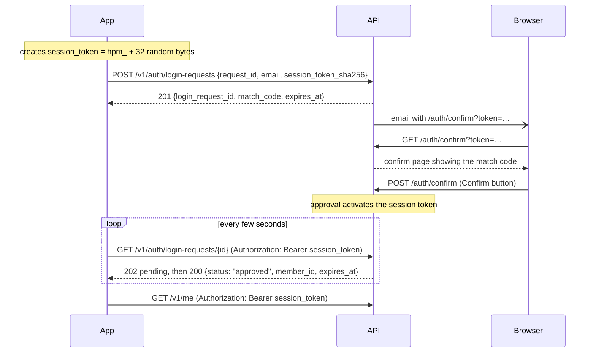

# api

Homeport's control plane: a Cloudflare Worker (TypeScript, [Hono](https://hono.dev)) with a D1 database.

So far it covers email magic-link sign-in, sessions, `request_id` idempotency, sharing devices, lines and WireGuard peers. Later PRs add the credits ledger, Stripe Identity, Checkout and the gateway endpoints.

## Requirements

- Node.js 26 (`.nvmrc`)
- npm (the lockfile is `package-lock.json`)

Wrangler is a dev dependency, so no global install is needed.

## Develop

```bash
npm ci
cp .dev.vars.example .dev.vars
npm run migrate:local
npm run dev
```

`.dev.vars` sets `ENVIRONMENT=dev` and `EMAIL_MODE=log`, so sign-in links are written to the `wrangler dev` log instead of being emailed.

| Script | What it does |
| --- | --- |
| `npm run dev` | `wrangler dev` with a local D1 database |
| `npm test` | Vitest inside the Workers runtime (`@cloudflare/vitest-plugin`); migrations are applied in `test/apply-migrations.ts` |
| `npm run lint` | ESLint with type-aware rules, including `no-floating-promises` |
| `npm run typecheck` | `tsc` for `src/` and `test/` |
| `npm run types` | Regenerates `worker-configuration.d.ts` after a change to `wrangler.jsonc`; CI fails if it is stale |
| `npm run migrate:local` | Applies `migrations/` to the local D1 database |

## Configuration

| Name | Values | Default in `wrangler.jsonc` |
| --- | --- | --- |
| `ENVIRONMENT` | `dev` enables the `/dev` routes and email log mode; anything else is production | `production` |
| `EMAIL_MODE` | `log` writes sign-in links to the log, and works only when `ENVIRONMENT=dev`. Real delivery comes in a later PR; until then, other values return `503 email_unavailable` | `disabled` |
| `PUBLIC_BASE_URL` | Origin used to build the links in sign-in emails. Without a valid http(s) URL no link is sent (`503 email_unavailable`) | empty |
| `DB` | D1 database `homeport`, migrations in `migrations/` | |

## Sign-in

The desktop app signs in by polling, so it needs no custom URL scheme. The endpoints follow the contract in `contracts/control-api.openapi.yaml` (operations `createLoginRequest`, `getLoginRequest`, `deleteSession` and `getMe`; added in jermainee/homeport#7).



1. The app creates its session token, `hpm_` plus 32 random bytes in base64url, and keeps it.
2. `POST /v1/auth/login-requests` takes `{request_id, email, session_token_sha256}`. It returns `{login_request_id, match_code, expires_at}` and sends the link. The response is the same whether or not the email belongs to a member. The app shows the match code.
3. Opening the link shows a confirm page with the same match code. Opening it changes nothing, so mail scanners that prefetch links cannot sign anyone in. The member checks that the codes agree and clicks Confirm. The form posts the code back, and the API approves only if it agrees with the request's code. Approval creates the member on first sign-in and activates the app's session token.
4. `GET /v1/auth/login-requests/{id}` with `Authorization: Bearer <session_token>` polls the sign-in. The token works here before approval and nowhere else. A poll only reads, so it carries no `request_id`, and every response has `Cache-Control: no-store`. Responses:
   - `202 {status: "pending"}` until the member approves;
   - `200 {status: "approved", member_id, expires_at}` on every poll after that, until the request expires (`expires_at` is when the session token stops working);
   - `401 unauthorized` for a missing or malformed token;
   - `404 not_found` for a token that belongs to another request;
   - `410 login_request_expired` once the request has expired.
5. `GET /v1/me` with `Authorization: Bearer <session_token>` returns `{member_id, email, identity_status, credits}`, or `401` without a live session. Credits are all 0 until the ledger lands.
6. `DELETE /v1/auth/session` revokes the session it is called with: `204`, or `401`.

No response carries a secret, so replaying one by `request_id` is harmless.

### `request_id`

Every POST under `/v1` carries a `request_id`, a UUIDv7 the client creates once and reuses on retries (`src/idempotency.ts`).

- A retry with the same `request_id` and body gets the first response again, status and body.
- The same `request_id` with another body, on another endpoint, or from another signed-in member, gets `409 idempotency_conflict`. Behind a session the member is part of the request, so no member sees another member's response.
- A `request_id` older than 24 hours gets `400 request_id_expired`. One more than 1 hour in the future gets `400 invalid_request`.
- While the first request is still running, a retry gets `429 rate_limited` with `Retry-After: 1`. A first request that stays silent for a minute (an evicted isolate, a cancelled request) is taken over by the next retry.
- 5xx responses are not kept, so a retry runs again.
- Records live 25 hours. Only a SHA-256 fingerprint of method, path, member and body is stored, never the body.

### Rules the code enforces

- The API stores the session token and the link token only as SHA-256 hashes. A session token can start only one login request.
- A link is single-use and expires 15 minutes after the request, together with the request.
- Once approved, a request answers polls for at least 5 more minutes, so an approval just before expiry still reaches the app.
- Sessions last 90 days from approval.
- The match code is a six-digit number. It is not a secret, so it is stored as is.
- Request schemas are closed: an unknown field gets `400 invalid_request`. Errors are `{error, message?}`.
- Request bodies over the route's limit get `413 payload_too_large`: 16 KB by default, 128 KB for the gateway batch endpoints, as each operation's `x-max-body-bytes` in the contract says (`src/body-limits.ts`).
- Logs and traces drop query strings (`observability.redact_query_string`), so link tokens never reach them.

## Sharing and using lines

All endpoints follow the contract (`registerDevice`, `createLine`, `updateLine`, `listAvailableLines`, `createWireguardPeer`, `listWireguardPeers`, `deleteWireguardPeer`).

- **Devices.** `POST /v1/devices` stores a sharing agent's raw Ed25519 key and returns `spki_sha256`, the SHA-256 of its SubjectPublicKeyInfo (DER), which the gateway checks during mutual TLS. Registering a key again returns the same device with 200; a key another member registered gets `409 agent_key_taken`. A member can register 10 new devices a day; more get `429 rate_limited` with `Retry-After`. Devices need no identity check, as the contract has none for them: the app registers its key when it is installed.
- **Lines.** `POST /v1/lines {device_id}` creates the device's line on the newest gateway and returns where the agent dials out to; a device has one line (a second call returns it with 200). Its country, city and ISP come from Cloudflare's view of that request (`request.cf`), since the device is at home then; line tests will replace them. A line starts with sharing off; `PATCH /v1/lines/{id} {sharing_enabled}` switches it.
- **Available lines.** `GET /v1/lines/available` lists sharing lines with a known country, minus the member's own lines, lines of linked members, lines of suspended owners and full lines.
- **WireGuard peers.** The client creates the device's X25519 key pair and sends only the public key, so the API never sees a private key; `config_text` holds `{{PRIVATE_KEY}}` where the client puts it. Each peer gets one host number used in both tunnel networks: `10.77.a.b` (host = a × 256 + b, from 2 to 65534; `10.77.0.1` is the gateway) and `fd77::<host in hex>` in `fd77::/64`. One atomic insert takes the lowest free number. The config sets `DNS = 10.77.0.1`, `MTU = 1280`, `AllowedIPs = 0.0.0.0/0, ::/0`, `PersistentKeepalive = 25` and the line's gateway as `Endpoint` and `PublicKey`. A key in use by another peer gets `409 public_key_taken`. A member can have 20 active peers (`MAX_PEERS_PER_MEMBER`), so no account can use up the shared address pool; the 21st gets `429 rate_limited` until one is deleted. Names count characters (code points), as the contract does. Deleting a peer keeps its row (`deleted_at`), so late usage still finds its member, and frees its key and address.
- **No self-dealing.** A member never uses their own line, or a line whose owner is linked to them: a `member_links` row in either direction (household, device, card, Connect account), or sessions from the same app install (`auth_sessions.install_id`). Such a line is missing from the available list, and a peer for it gets `403 line_not_allowed`.
- **Shared lines** serve at most 3 members besides their owner (`MAX_USERS_PER_LINE`); a fourth gets `409 line_full`, while a member already on the line can add devices.
- **Identity.** Lines, the available list and new peers answer `403 identity_required` until the member passed Stripe Identity (`src/identity/require-verified.ts`). The check runs before `request_id` handling, so a 403 is not stored for a `request_id`. Listing and deleting one's own peers work without it.

## Dev-only routes

Routes under `/dev` answer `404` unless `ENVIRONMENT` is exactly `dev`.

- `POST /dev/login-requests/{id}/confirm` with `{session_token}` approves a login request without the email link, so automated tests can sign in.
- `PUT /dev/gateways/{id}` with the contract's `GatewaySelf` body stores a gateway, so lines and WireGuard configs can be created locally before gateways authenticate (`PUT /v1/gateway/self`, a later PR).

## Database

- `migrations/0001_magic_link_auth.sql` creates `members`, `login_requests`, `magic_link_tokens`, `auth_sessions` and `idempotency_records`.
- `migrations/0004_lines_and_peers.sql` creates `gateways`, `devices`, `lines`, `wireguard_peers` and `member_links`, and indexes `auth_sessions.install_id`.

Timestamps are Unix epoch milliseconds. Schema changes ship as new numbered migration files; the deploy workflow (a later PR) applies them.
