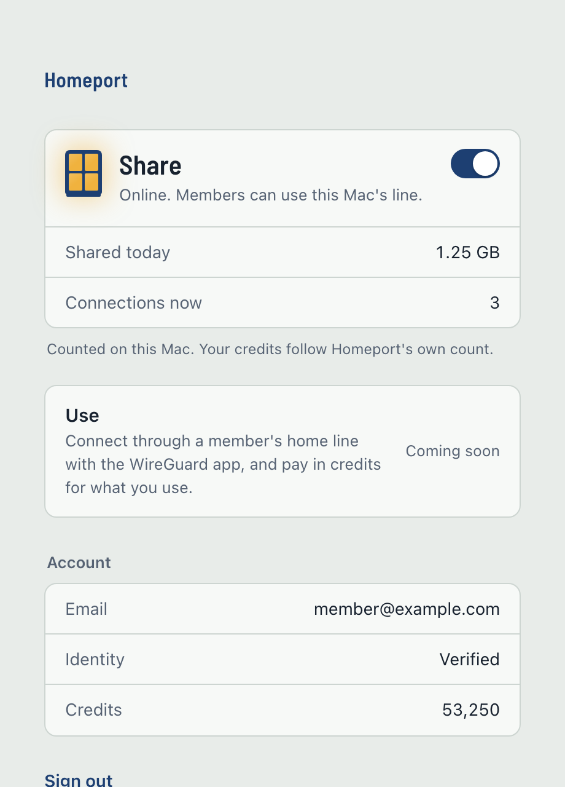
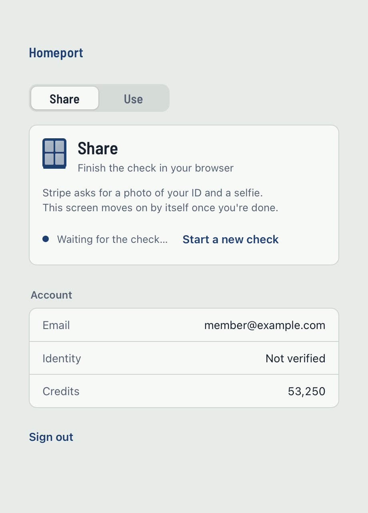
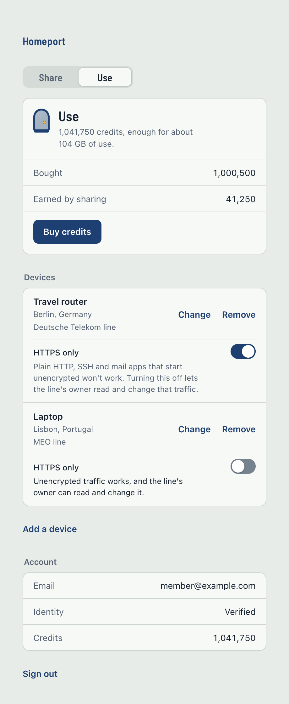
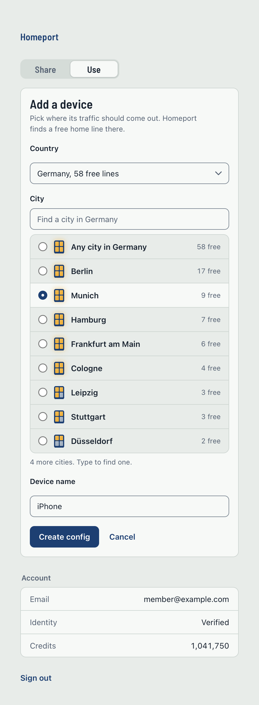
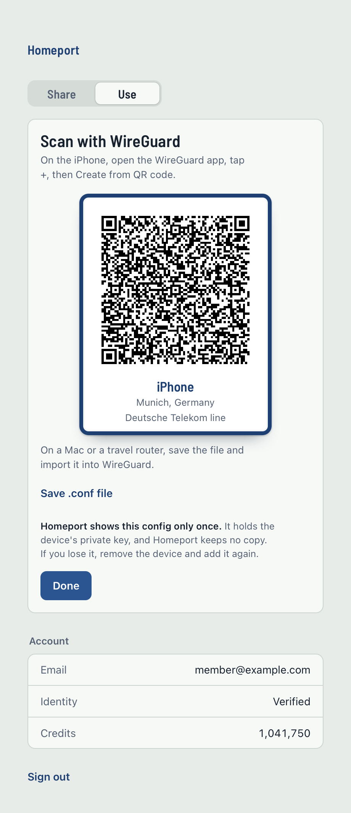
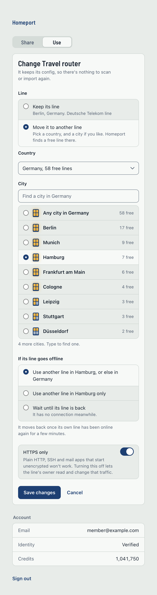

# desktop-app

The Homeport app for Linux, macOS and Windows, built with [Wails v3](https://v3.wails.io): a Go backend and a TypeScript + Vite frontend in the OS webview. macOS comes first.

It signs the member in with an email link and runs the Stripe Identity check that every member passes before Share or Use turns on. Then it has two tabs:

- **Share** shares this Mac's home line: the switch runs the sharing agent from [`agent/`](../agent/README.md) inside the app.
- **Use** shows the member's credits, buys more through Stripe Checkout, and adds devices that use another member's line with the official WireGuard app: a QR code for the iPhone, or a `.conf` file for a Mac or a travel router. The member picks a country, and optionally a city, each with how many lines are free there; the API assigns the line, and the app shows its city and ISP. A country with more than 8 cities gets a search field, so the list stays short at any size.

  

   

The screenshots after sign-in are the dev preview (for example `?preview=home&share=online&tab=use`), which runs the real screens against fake data. The QR code in it is real: it holds a config with a throwaway key.

## Requirements

- Go 1.27 (`go.mod`)
- Node.js 26 (`frontend/.nvmrc`)
- The Wails CLI, pinned to the same version as the `github.com/wailsapp/wails/v3` module:

  ```bash
  go install github.com/wailsapp/wails/v3/cmd/wails3@v3.1.0
  ```

  Run `wails3 doctor` to check the toolchain. To upgrade Wails, change the version in `go.mod`, `frontend/package.json` (`@wailsio/runtime`), `.github/workflows/desktop-app-ci.yml` and here, all at once.

## Develop

Start the API first (see `../api/README.md`); its sign-in links appear in the `wrangler dev` log. Then:

```bash
wails3 dev
```

| Variable | What it does | Default |
| --- | --- | --- |
| `HOMEPORT_API` | API base URL | `http://localhost:8787` |
| `HOMEPORT_PROFILE` | Profile directory: install id, session, and each member's agent key and Share state | `~/Library/Application Support/Homeport` on macOS |

To run two accounts side by side, give each its own profile. Run the second one from a build, because two `wails3 dev` instances collide on the Vite port:

```bash
wails3 build
HOMEPORT_PROFILE=/tmp/homeport-b ./bin/homeport
```

Share needs a member whose identity is verified and a gateway that has announced itself to the API (`PUT /dev/gateways/{id}` until the gateway does it, see `../api/README.md`). The agent connects once that gateway lists the device.

"Verify identity" and "Buy credits" open Stripe's test-mode pages in the browser, so the API needs its Stripe test keys and `stripe listen` forwarding the webhooks (see `../api/README.md`). Pay with the test card 4242 4242 4242 4242.

### Designing the screens in a browser

`npm run dev` in `frontend/` serves the UI without Go. Add `?preview=<state>` to run it against a fake AuthService: `signedOut`, `approve` (approves after a few polls), `offline`, `expired`, `home` or `unreachable`. On `home`:

- `&share=<state>` sets the fake ShareService: `off`, `connecting`, `online`, `paused`, `offline`, `gateway` or `error`, or `unverified`, `processing` or `requires_input` for the member's identity. "Verify identity" then runs a fake check that ends verified.
- `&use=<state>` sets the fake UseService: `ready`, `empty` or `broke` (no devices, no credits), `backup` (the travel router's line is offline, so it runs on a backup line), or `unreachable`. The laptop has HTTPS only off, so both positions of the switch show.
- `&tab=use` opens the Use tab.

Production builds leave the fakes out.

## Test

```bash
go test -race ./...
cd frontend && npm test
```

- `services/auth_test.go` tests `AuthService` against `internal/fakeapi`, an in-memory stand-in for the API's member and share endpoints.
- `services/share_test.go` tests `ShareService` against the same fake API, with a fake agent behind the `services.Agent` interface: enrollment, the line and its gateway pin, the switch, retries while the API or a gateway is unavailable, a VPN that blocks the line, today's count, sign-out and restarts.
- `services/identity_test.go` tests `IdentityService`: the check's page opens in the browser, a retry reuses the request, and polling reports each step, including a new check after a failed one.
- `services/use_test.go` tests `UseService`: the balance in credits and bytes, Checkout and waiting for the credits, the lines, and new devices. It decodes each QR code with gozxing, checks that the config's private key belongs to the public key the API got and is stored nowhere, and covers the save path, the file's permissions and the config's single showing. It also covers each device's exit line, moving a device or changing its failover, and turning HTTPS only off and on, with the API's refusals.
- `frontend/src/signin.test.ts`, `share.test.ts`, `identity.test.ts` and `use.test.ts` test the state machines against fakes of the Go services (`src/test/`), with fake timers for polling.
- `frontend/src/ui.test.ts`, `ui-share.test.ts`, `ui-use.test.ts` and `view.test.ts` test focus, announcements, tabs and rendering in happy-dom.

## How it fits together

| Path | What it is |
| --- | --- |
| `main.go` | Opens the profile, creates the API client, the services, the window and the tray |
| `services/` | Wails services the frontend calls. The webview never calls the API, so the session token never reaches JavaScript |
| `services/share.go` | `ShareService`: enrolls this computer, turns sharing on and off at the API and runs the agent |
| `services/identity.go` | `IdentityService`: opens the Stripe Identity check in the browser and polls how it stands |
| `services/use.go` | `UseService`: credits, Checkout, lines, and devices with their WireGuard config and QR code, their line, failover and HTTPS only |
| `internal/apiclient/` | Client for the member and share endpoints in `contracts/control-api.openapi.yaml` |
| `internal/profile/` | Profile directory: a stable install id, the session, and per member (`members/<id>/`) the agent key and Share state |
| `internal/tray/` | The menu bar icon and menu: Share status, the Share switch, Open and Quit. `icons/gen.go` draws its icons |
| `e2e_guard.go` | Stops the app from building with the agent's `e2e` test tag |
| `frontend/src/signin.ts`, `share.ts`, `identity.ts`, `use.ts` | The sign-in, Share, identity and Use state machines; `poll.ts` is their polling |
| `frontend/src/view.ts`, `view-use.ts`, `ui.ts` | Render each state and wire up the window; `text.ts` holds the shared wording, `style.css` the design tokens |
| `frontend/src/auth.ts`, `share-api.ts`, `identity-api.ts`, `use-api.ts` | Connect the state machines to the generated bindings and Share's status events |
| `frontend/bindings/` | TypeScript bindings generated by `wails3 build`. Commit them; CI fails if they are stale |

Sign-in follows the contract: the app creates the session token (`hpm_` and 32 random bytes), sends only its SHA-256, shows the match code and polls until the member confirms the code on the page behind the email link. A retry after a lost response reuses the same `request_id`, so the member gets one email, not two.

The session token is stored in `session.json` in the profile, readable only by the user. Unsigned dev builds can't use the macOS Keychain without a prompt after every rebuild; the Keychain comes with signed release builds.

### Share

Turning Share on runs these steps, and the switch shows the outcome of the first attempt:

1. `GET /v1/me`: Share needs a verified identity. Otherwise the Share screen asks the member to verify first.
2. On first use, the app creates the agent's Ed25519 key (`members/<id>/agent-key.pem`, readable only by the user) and registers it with `POST /v1/devices`.
3. `POST /v1/lines` returns the device's line and its gateway. The contract sends the gateway's pin as the hex SHA-256 of its SPKI; the app turns it into relay-protocol's `Pin`, whose text form is base64. The agent pins it, so the gateway's `server_name` is not needed.
4. `PATCH /v1/lines/{id}` turns sharing on, and the agent dials the gateway.

While the API or a gateway can't be reached, Share stays on and tries again, from 1 s doubling to 1 minute, or later if the API's `Retry-After` asks for it. An error that retrying won't fix turns Share off and says why. The screen and the tray show the agent's state: connecting, online, paused while only a VPN reaches the internet, or offline. Share keeps running while a VPN, such as a Homeport Use tunnel, carries this computer's default route: the agent binds its sockets to the home line's interface (see `agent/README.md`).

"Shared today" is the agent's own count of payload bytes, kept per day in `members/<id>/share.json` across restarts. Credits follow the gateway's count, which includes packet headers.

Closing the window keeps Share running in the menu bar. Quit stops the agent but keeps the member's choice, so Share turns on again at the next start, unless the member turns it off before then. Turning Share off, or signing out, stops the agent first and then tells the API; a turn-off the API missed is sent with the next turn-off or at the next start. A session that ends elsewhere, or runs out, turns Share off as well.

### Identity

"Verify identity", on the Share or the Use tab, asks the API for a Stripe Identity session (`POST /v1/identity/sessions`) and opens its page in the system browser. The app then polls `GET /v1/me` every 3 seconds, for up to 30 minutes, and shows each step: waiting for the member, being checked, verified, or not passed. A check already being processed is followed from the start. The API keeps a failed check's `requires_input` until Stripe reports on the next one, so after "Try again" the app waits until the status moves. Once verified, Share and Use turn on without a restart.

### Use

- **Credits:** `GET /v1/me` gives the bought and earned credits. The app shows what they buy in bytes, at 10 credits per MB (10,000 credits = 1 GB); `bytesPerCredit` in `services/use.go` is its only copy of that price until the API serves it.
- **Buy credits:** `POST /v1/checkout/sessions` opens Stripe Checkout in the browser. The app polls `GET /v1/me` every 3 seconds, for up to 10 minutes, until the purchased credits rise above where they were; spending meanwhile lowers that mark.
- **Lines:** `GET /v1/lines/available` lists the lines the member can use, with country, city, ISP and whether the line is online. The API leaves out the member's own lines and lines linked to them.
- **Add a device:** the app makes the device's X25519 key pair and sends only the public key with `POST /v1/wireguard/peers`. It sends HTTPS only as the Add form has it (on unless the member turns it off). It puts the private key into the returned `config_text` and keeps the config in memory only, as a QR code for the WireGuard app and for "Save .conf file" (written `0600`). Done, signing out or quitting drops it; nothing can show it again. A device whose config is lost is removed and added again.
- **Devices:** `GET /v1/wireguard/peers` lists them, and Remove deletes one (`DELETE /v1/wireguard/peers/{id}`). The API doesn't report usage per device yet. While the Use tab shows the list, the app reloads the devices (not the lines) every 30 seconds.
- **Backup lines:** while a device's line is offline, the gateway moves it to another line in the same city, then the same country, as the device's failover allows, and back once its own line has been online for 5 minutes. The list says when a device runs on a backup line, and where, from the peer's `exit_line`.
- **Change a device:** Change keeps the device's line, or moves it to another free line in a country, and optionally a city, picked as in Add a device; and it sets the failover: same city then same country (the default), same city only, or off; and HTTPS only. `PATCH /v1/wireguard/peers/{id}` sends only what changed, in one request, and the device keeps its config. The API picks the new line on the gateway the device's config names, never its current one, and answers `409 no_free_line` when the region has no other free line there; a 404 means the device was removed.
- **HTTPS only:** every device starts with it on, unless the Add form turns it off, and its row has a switch for it, as does the Change form. While it's on, the gateway lets through only the device's TCP that opens with TLS, so plain HTTP, SSH and mail apps that start unencrypted don't work; the row says so, and that turning it off lets the line's owner read and change that traffic. The row's switch acts at once and sends only `https_only` with `PATCH /v1/wireguard/peers/{id}`, keeps the device's config, and resets its open connections within about 30 seconds. DNS through Homeport and UDP aren't affected.

POSTs reuse their `request_id` (and for a device, its key pair) after a response that never arrived, so a retry gets the first answer instead of a second Stripe session or peer.

## Build and release

- `wails3 build` builds the frontend, regenerates the bindings and writes `bin/homeport`. CI fails if it changes any tracked file.
- The app version is `info.version` in `build/config.yml`. CI fails a pull request that changes this folder, `agent/` or `relay-protocol/` without raising it, because the app ships the agent. A release workflow (later) will publish `desktop-app-v<version>`.
- The release build must never carry the agent's `e2e` tag; `e2e_guard.go` makes it fail to compile, and CI checks that.
- After changing `info` in `build/config.yml`, run `wails3 task common:update:build-assets`, then delete the `build/ios/` folder it recreates and set `LSMinimumSystemVersion` back to `26.0.0` in both plists. Homeport supports only the latest macOS.
- Git tracks `frontend/dist/.gitkeep` so that `//go:embed all:frontend/dist` compiles on a fresh clone; the Vite build puts it back after emptying `dist/`.
- Builds don't regenerate the app icons, because `actool` writes a different `Assets.car` on every run. After changing `build/appicon.png` or `build/appicon.icon`, run `wails3 task common:generate:icons` and commit the result.
