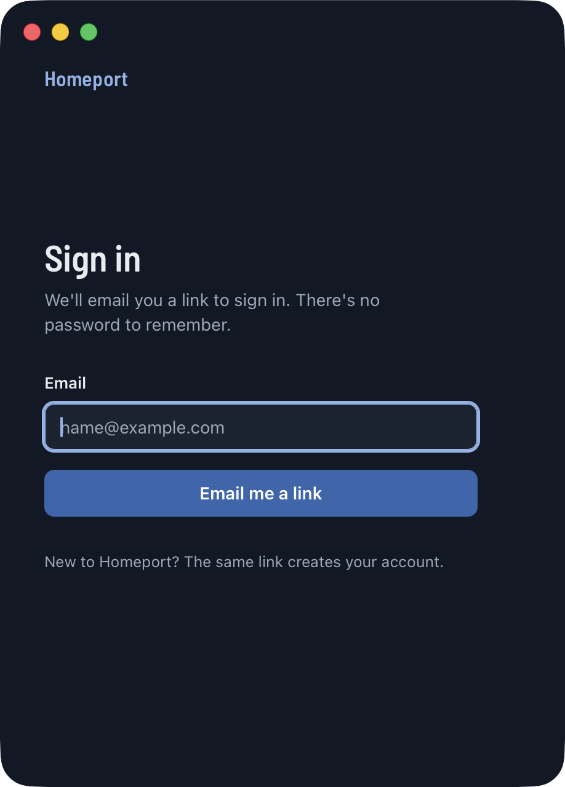

# desktop-app

The Homeport app for Linux, macOS and Windows, built with [Wails v3](https://v3.wails.io): a Go backend and a TypeScript + Vite frontend in the OS webview. macOS comes first.

So far it signs the member in with an email link and shows a home screen with placeholders for Share and Use. Later PRs embed the sharing agent (Share) and add identity, credits and WireGuard configs (Use).



## Requirements

- Go 1.27 (`go.mod`)
- Node.js 26 (`frontend/.nvmrc`)
- The Wails CLI, pinned to the same version as the `github.com/wailsapp/wails/v3` module:

  ```bash
  go install github.com/wailsapp/wails/v3/cmd/wails3@v3.1.0
  ```

  Run `wails3 doctor` to check the toolchain. To upgrade Wails, change the version in `go.mod`, `frontend/package.json` (`@wailsio/runtime`), `.github/workflows/desktop-app-ci.yml` and here, all at once.

## Develop

Start the API first (see `../api/README.md`); its sign-in links appear in the `wrangler dev` log. Then:

```bash
wails3 dev
```

| Variable | What it does | Default |
| --- | --- | --- |
| `HOMEPORT_API` | API base URL | `http://localhost:8787` |
| `HOMEPORT_PROFILE` | Profile directory: install id and session | `~/Library/Application Support/Homeport` on macOS |

To run two accounts side by side, give each its own profile. Run the second one from a build, because two `wails3 dev` instances collide on the Vite port:

```bash
wails3 build
HOMEPORT_PROFILE=/tmp/homeport-b ./bin/homeport
```

### Designing the screens in a browser

`npm run dev` in `frontend/` serves the UI without Go. Add `?preview=<state>` to run it against a fake AuthService: `signedOut`, `approve` (approves after a few polls), `offline`, `expired`, `home` or `unreachable`. Production builds leave the fake out.

## Test

```bash
go test -race ./...
cd frontend && npm test
```

- `services/auth_test.go` tests `AuthService` against `internal/fakeapi`, an in-memory stand-in for the API's member endpoints.
- `frontend/src/signin.test.ts` tests the sign-in state machine against a fake `AuthApi` (`src/test/fake-auth.ts`), with fake timers for polling.
- `frontend/src/ui.test.ts` and `view.test.ts` test focus, announcements and rendering in happy-dom.

## How it fits together

| Path | What it is |
| --- | --- |
| `main.go` | Opens the profile, creates the API client and the window |
| `services/` | Wails services the frontend calls. The webview never calls the API, so the session token never reaches JavaScript |
| `internal/apiclient/` | Client for the member endpoints in `contracts/control-api.openapi.yaml` |
| `internal/profile/` | Profile directory: a stable install id and the session |
| `frontend/src/signin.ts` | Sign-in state machine: polling, backoff, expiry |
| `frontend/src/view.ts`, `ui.ts` | Render each state and wire up the window; `style.css` holds the design tokens |
| `frontend/bindings/` | TypeScript bindings generated by `wails3 build`. Commit them; CI fails if they are stale |

Sign-in follows the contract: the app creates the session token (`hpm_` and 32 random bytes), sends only its SHA-256, shows the match code and polls until the member confirms the code on the page behind the email link. A retry after a lost response reuses the same `request_id`, so the member gets one email, not two.

The session token is stored in `session.json` in the profile, readable only by the user. Unsigned dev builds can't use the macOS Keychain without a prompt after every rebuild; the Keychain comes with signed release builds.

## Build and release

- `wails3 build` builds the frontend, regenerates the bindings and writes `bin/homeport`. CI fails if it changes any tracked file.
- The app version is `info.version` in `build/config.yml`. CI fails a pull request that changes this folder without raising it. A release workflow (later) will publish `desktop-app-v<version>`.
- After changing `info` in `build/config.yml`, run `wails3 task common:update:build-assets`, then delete the `build/ios/` folder it recreates and set `LSMinimumSystemVersion` back to `26.0.0` in both plists. Homeport supports only the latest macOS.
- Git tracks `frontend/dist/.gitkeep` so that `//go:embed all:frontend/dist` compiles on a fresh clone; the Vite build puts it back after emptying `dist/`.
- Builds don't regenerate the app icons, because `actool` writes a different `Assets.car` on every run. After changing `build/appicon.png` or `build/appicon.icon`, run `wails3 task common:generate:icons` and commit the result.
