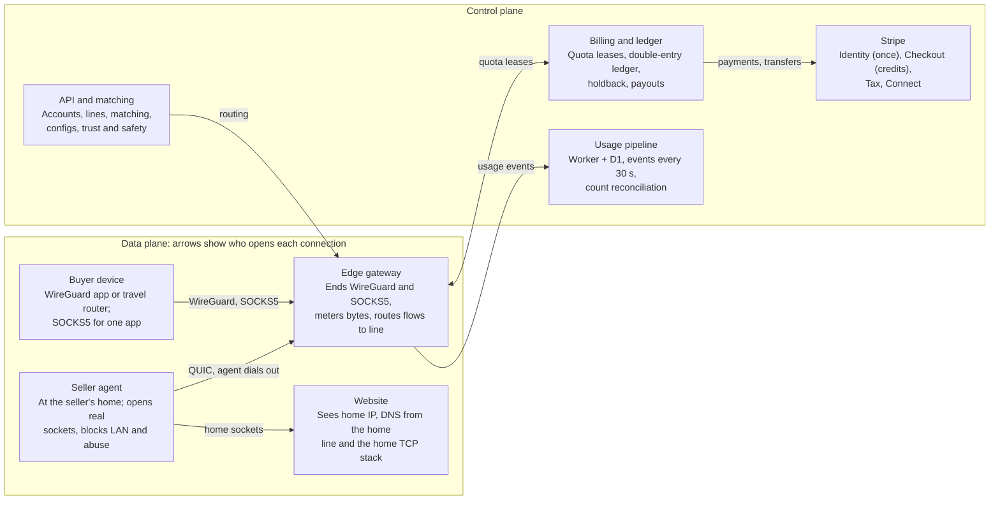
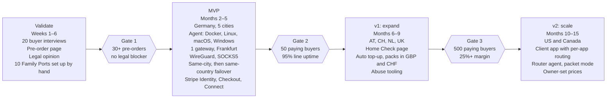

# Homeport — Residential Line Marketplace (Concept)

> Exported from the [Claude Docs concept](https://claude.ai/artifact/3XH7c5NjRbqdE9W4cY8zgv) on 2026-11-13. This file is now the source of truth: change it through a pull request.

## Summary

Homeport (working title) is one app with one account for both sides. Members switch on Share to rent out their home internet line as a residential exit, and Use to connect through a home line in their own country while abroad. Billing runs on credits: each MB used costs 10, each MB shared earns 5, and the platform keeps the difference.

Six decisions shape the concept:

1. **One account, two modes.** Every member verifies once and can switch on Share, Use or both. Earned credits pay for a member's own usage, so travellers who leave a home line behind become suppliers too.
2. **Dedicated lines, not a rotating pool.** Each buyer gets one stable home line, either exclusive or shared with at most two others. A stable home IP is what banks and government portals expect, and it keeps lines out of proxy-detection databases.
3. **Relay architecture first.** Seller agents dial out to regional edge gateways, and buyers connect to the same gateway over WireGuard or SOCKS5. This works behind any NAT or CGNAT, and the platform controls every byte.
4. **The gateway is the meter of record.** Bytes are counted at the edge per WireGuard peer or SOCKS5 login, so a plain travel router is metered like the app. Credits are enforced in real time, and a double-entry ledger moves 10 credits per MB from the user: 5 to the line's owner, 5 to the platform.
5. **Accountable, not anonymous.** Every member passes Stripe Identity (ID document + selfie) once, before Share or Use turns on, so every session traces to two verified people. The platform keeps minimal session metadata (which buyer used which line, when) so it can answer abuse reports and shield sellers.
6. **Stripe Connect with the platform as merchant of record.** Credits sell at €40 net per 100 GB. Members who cash out earned credits get a Connect account and a monthly transfer after a 30-day holdback.

The largest risk is not technical: the seller's IP is the exit, so seller liability and ISP contract terms must be solved before scaling. The second is economic: per-MB credits alone earn an owner about €1 a month from one light user, so exclusive lines add a daily reservation.

## Problem and target users

Nomads and expats need to look like they are at home online, and every common workaround can be detected. The one setup that works, a real home line, needs a home, hardware and someone on site to fix it.

**Buyers (demand side)**

| Segment | Why they need a home IP | Expected volume |
| --- | --- | --- |
| Digital nomads | Banks, brokers and payment apps flag or block foreign IPs; 2FA and fraud checks lock accounts | 2–10 GB/month if only key apps are routed |
| Long-term expats | Tax and government portals, insurance, telecom and local shops that geo-restrict | 2–10 GB/month |
| Location-independent sellers | Marketplace, ads and payment accounts that flag logins from new countries | 5–30 GB/month |
| Full-tunnel users | Everything through home, including video calls | 30–100 GB/month (€12–40 of credits per month) |

Volumes are planning assumptions to validate in interviews.

**Sellers (supply side)**

Households with always-on fixed broadband (fiber or cable, at least 20 Mbit/s upload) in high-demand countries: Germany, Austria, Switzerland, UK, Netherlands, France, US, Canada, Australia. They earn credits from idle upload capacity and spend them or cash them out. A strong early channel is friends and family of nomads: parents host a node, the nomad uses it, both in the same app. Members who keep a home line while travelling can share it and fund their own usage.

**Why existing options fail**

| Option | What websites see | Why it fails |
| --- | --- | --- |
| Commercial VPN | Datacenter ASN, IP on public VPN lists, shared by thousands | Banks and portals block it or force extra checks |
| "ISP" or static residential proxy | ISP-registered IP, physically hosted in a datacenter | Routing, latency and open ports give it away; detection vendors flag these ranges |
| Rotating residential pool | Real home IPs, a different one per session, shared with scrapers | Detection vendors buy access and tag every exit; rotation itself triggers fraud checks; supply often comes from bundled SDKs |
| DIY home router + travel router | Your own home IP | Best fidelity, but needs a home, hardware, technical skill and someone to reboot it |

Homeport turns the DIY setup into a product: a real, stable home line in your country, without having to own one.

## Product

A buyer rents one specific home line (a "Port") in a chosen country and city and keeps it for months. Rotation is the exception, used only for failover.

**One account, two modes**

Every member has one account, one identity check and one credit balance. In this doc, buyer and seller mean a member in Use or Share mode.

|  | Use | Share |
| --- | --- | --- |
| What it does | Connects through a home line in another country | Rents out the member's own home line |
| Turns on after | Identity check, plus a credit pack or earned credits | Identity check, agent installed, line test passed |
| Credits | −10 per MB used | +5 per MB served |
| Typical device | Laptop, phone or travel router | Always-on box at home: desktop, NAS, Raspberry Pi |
| Stripe Connect | Not needed | Only to cash out |

- A ban, a chargeback or a failed re-check applies to both modes.
- A member never uses their own line, or a line linked to them by household, device, card or Connect account (see Trust).
- A line is a network, not a device. If a sharing device moves to another network (new ISP, IP range or country), Share pauses until that network passes the line test.
- One device does one job at a time. The desktop app pauses Share while its own Use tunnel is on, so shared traffic never leaves through someone else's line.

**Line types**

| Type | Who uses the line | Credits | Best for |
| --- | --- | --- | --- |
| Exclusive Port | One buyer, plus the seller's own household | Daily reservation + per MB | Banking, business and marketplace accounts |
| Shared Port | Up to 3 verified buyers | Per MB only | Lighter use, lower price |
| Family Port | A line the buyer's own relative hosts, reserved for that buyer | Per MB; the relative may waive the reservation | Nomads with family at home; strongest trust and a viral loop |

**Use flow**

1. Sign up once and pass Stripe Identity (ID document + selfie). Neither mode turns on before verification succeeds.
2. Pick country, then city, optionally ISP. Each line shows uptime, upload speed and IPv6 support.
3. Buy credits (100 GB for €40 net) or use earned credits, then get a WireGuard config per device (file or QR code) plus SOCKS5 credentials.
4. Connect with the official WireGuard app, or load the config into a travel router (GL.iNet, OpenWrt) so every device behind it goes through home. Usage is metered on the gateway, so the router needs no Homeport software.
5. Run the built-in Home Check: it shows exactly what websites see (IP, ISP, DNS resolver, IPv6, WebRTC, timezone mismatch).
6. Track usage per device and the credit balance; get alerts at low balance, when the line drops or when its IP changes. While the line is down, devices move on their own to a backup line in the same city, else the same country, and come back once the line has been up for 5 minutes. The WireGuard config never changes, and a device can be moved to another line with one click.

**Share flow**

1. Install the agent: desktop app (Linux, macOS, Windows) or Docker image (NAS, Raspberry Pi, home server). Router firmware and Android come later.
2. Switch on Share; the identity check from signup already covers it. A bank account through Stripe Connect is needed only to cash out.
3. Set limits: GB per month, maximum share of upload speed, schedule, pause button.
4. The agent tests the line; it is listed once it passes (residential ISP, enough upload, clean IP reputation).
5. Earn 5 credits per MB served, plus 5,000 credits a day while a user reserves your line exclusively. Spend them at once on your own usage, or cash them out monthly once they clear a 30-day holdback.
6. Stay protected: the platform answers abuse reports, and the seller's home network is unreachable for buyers.

**Core features**

- Sticky lines with alerts on IP change, plus automatic failover: same city first, then same country
- Plain WireGuard, so it works on travel routers, phones, laptops and TVs
- Desktop app for the latest Linux, macOS and Windows releases; older OS versions are out of scope
- Split tunneling guide in v1 (route only banking and admin apps); own client app with per-app routing later
- Home Check page for leak and consistency tests
- Stripe Identity mandatory for every member; members never see each other's identity
- One dashboard: credit balance (bought and earned), usage per device, MB served, uptime score and sharing controls

## Business model and unit economics

The platform keeps half of every MB: the user pays 10 credits, the line's owner earns 5, the platform keeps 5. Credits sell at €40 net per 100 GB, so owners earn €0.20 per GB. After Stripe, payout and infrastructure costs, the platform keeps about 34% of a pack.

**Credits** (1 MB = 10^6 bytes, upload plus download; net prices, VAT added at checkout)

| Event | Credits | Net value |
| --- | --- | --- |
| Use 1 MB | −10 | €0.0004 |
| Share 1 MB | +5 | €0.0002 |
| Use 1 GB | −10,000 | €0.40 |
| Share 1 GB | +5,000 | €0.20 |
| Reserve an exclusive line for a day | −10,000 | €0.40 (about €12 a month) |
| Host a reserved exclusive line for a day | +5,000 | €0.20 (about €6 a month) |
| Buy a 100 GB pack | +1,000,000 | €40.00 (€47.60 gross with 19% VAT) |

One credit is worth €0.00004 net and pays for 100 kB, so the ledger counts whole credits and converts to euros only at purchase and cash-out. Purchased credits are spent first and can never be cashed out. Earned credits can be spent at once, or cashed out after a 30-day holdback.

Exclusive lines carry a daily reservation on top of usage, so an owner with one light user earns about €7 a month instead of €1. Days below 95% uptime are charged and paid pro rata, and a hosting relative can waive the reservation on a Family Port. If a balance cannot cover the next day, the user gets 3 days' notice before the line is released.

For comparison, bandwidth-sharing apps pay sellers about $0.10–0.20 per GB ([Honeygain comparison, Oct 2026](https://www.honeygain.com/blog/bandwidth-sharing-apps/)). Rotating residential proxies sell at $3.30–8.00 per GB ([AIMultiple, Oct 2026](https://aimultiple.com/proxy-pricing)). Homeport pays owners at the top of that range (€0.20 per GB) and charges users €0.40 per GB, well under a fifth of proxy list prices.

**Worked example: one 100 GB pack bought in Germany and used on one line**

| Line item | Amount | Basis |
| --- | --- | --- |
| User pays (net) | €40.00 | 1,000,000 credits; €47.60 gross with 19% VAT, which goes to the tax office |
| Line owner earns | −€20.00 | 500,000 credits (5 per MB × 100,000 MB) |
| Stripe on the charge | −€1.46 | Standard EEA card 1.5% + €0.25, Tax API €0.45, Radar €0.05; one-time payment, so no Billing fee |
| Stripe Connect payout | −€2.15 | €2 per active account + 0.25% + €0.10, if the owner cashes out that month; €0 if they spend the credits |
| Infrastructure | −€2.50 | Gateway servers and traffic at €0.025 per GB (assumption) |
| Identity checks | −€0.21 | Stripe Identity €1.25 once per member, user and owner, spread over 12 months |
| **Platform margin** | **€13.68** | **34% of net revenue** |

Fees from [Stripe pricing (DE)](https://stripe.com/de/pricing) and [Stripe Connect pricing (DE)](https://stripe.com/de/connect/pricing).

Three levers protect the margin:

- **Payout cadence.** Connect charges €2 for each month an owner receives a payout. A €25 minimum (625,000 credits) cuts that cost, and every credit spent in the app avoids it.
- **Local currency.** Non-EEA cards cost 3.15% + €0.25, plus 2% when currency is converted. Pricing in USD, GBP and AUD avoids the conversion fee.
- **Owner-set prices later.** In scarce cities, owners could charge more than 10 credits per MB, with the platform still keeping half. That turns it into a true marketplace.

At 1,000 active users at 5 GB a month each (the middle of the 2–10 GB range), usage alone earns a contribution margin of about €500 per month. If half of them reserve an exclusive line, it rises to about €2,900. A full-tunnel user at 50 GB a month brings about €6.70 from usage alone.

## System architecture

The system has two planes: a data plane that carries traffic from buyer device to edge gateway to seller agent to website, and a control plane that decides who may use which line and settles the money.

Both the buyer and the seller agent connect out to the gateway, so the seller's home never accepts inbound traffic. The gateway is the only place bytes are counted for billing.

- **Regions:** one gateway cluster per seller region, Frankfurt first. If a gateway fails, the agent reconnects to another in the same region within seconds, and the buyer keeps the same exit IP.
- **Control plane outage:** running sessions continue until their current quota lease is used up; only new sessions wait.
- **Agent authentication:** a key pair is created at enrollment and used for mutual TLS on the QUIC connection; the agent reports line status, public IP and speed through the gateway.

## Data plane and connection fidelity

The gateway ends the buyer's tunnel, and the seller agent opens real sockets from the home network. Websites therefore see a genuine home connection: home IP, DNS resolved from the home line and a home operating system's TCP stack.

**Path of one connection**

1. The seller agent holds one outbound QUIC connection (UDP 443, TLS 1.3, fallback to TLS over TCP 443) to the nearest edge gateway. The home opens no inbound ports, so it works behind CGNAT and DS-Lite.
2. The buyer connects to the same gateway, over WireGuard or SOCKS5 with username and password.
3. For WireGuard, the gateway runs a userspace network stack (wireguard-go with gVisor netstack, as Tailscale does) that turns the buyer's packets into TCP streams and UDP flows.
4. Each flow becomes a stream on the seller's QUIC connection, for example "open TCP to 203.0.113.7:443".
5. The agent opens a normal socket on the home machine and pipes bytes both ways.
6. DNS goes the same way: the gateway answers on a virtual DNS address, and the agent resolves each name over DNS over HTTPS (Cloudflare, then Quad9) through the home line. The resolver sees the home IP and answers for the home's region. Neither the seller's network nor their ISP can read or forge the answers, because the agent checks the resolver's certificate against root certificates built into the agent, not the machine's trust store. The agent never falls back to the seller's own resolver, which would let anyone who blocks DNS over HTTPS forge answers again. SOCKS5 clients use remote hostname resolution (socks5h).

**Failover**

A buyer keeps one line, but home lines go offline: a laptop sleeps, a router reboots. The line a device exits through is chosen on the gateway, not in its WireGuard config, so the gateway can move a device without the buyer touching it.

- Each device exits through its chosen line whenever that line is online.
- Once the line has been offline for 10 seconds, the gateway starts the device's next session on a backup line on the same gateway: a line in the same city first, then one in the same country. An agent that reconnects within those seconds keeps its devices, and their IP. The buyer can narrow this to the same city, or turn it off. Backup lines are spread over the buyers of one line, and all of one buyer's devices use the same backup, so they keep sharing one exit.
- Once the chosen line has been online for 5 minutes without a break, the device moves back. Moving ends open connections, so a flapping line does not move a device back and forth.
- A backup line passes the same checks as a chosen one: never the buyer's own line or a linked member's, and it must have room for one more user. Its owner earns from the sessions it carries.
- The app shows when a device runs on a backup line, and where.
- The gateway's config lists at most 5 backup lines per device, online ones first, since it is a full snapshot the gateway fetches every 30 seconds.
- Backup lines come from the device's own gateway only, because its WireGuard config names that gateway's endpoint and key. Failover across gateways is a later step: regional gateways that share one WireGuard key and endpoint (anycast), or that relay a peer's flows to each other.

Gateways sit in the seller's region (Frankfurt for German lines). The buyer's long leg is unavoidable, and the seller leg stays short and stable. The seller's upload is the speed limit: a 100/40 Mbit/s line shared at 50% gives the buyer about 20 Mbit/s down.

**Agent modes**

| Mode | Runs on | How traffic leaves | Trade-off |
| --- | --- | --- | --- |
| Socket mode (default) | Desktop app, Docker, no admin rights | Agent opens an OS socket per flow | TCP fingerprint is the seller's OS, not the buyer's |
| Packet mode (later) | Router firmware, Linux with network admin rights | Buyer packets are NATed at the home router | Buyer's own TCP fingerprint end to end, but the tunnel's smaller packet size becomes visible |

**What websites check, and how Homeport handles it**

| Signal | Homeport | Residual risk |
| --- | --- | --- |
| IP type and ISP | Real residential line | None |
| Proxy and VPN databases | Dedicated lines, verified buyers, low volume; daily reputation checks; flagged lines retired | Detection vendors may still find lines over time |
| DNS resolver | Resolved from the home line over DNS over HTTPS, by a public resolver near the home | A check that expects the home ISP's own resolver sees Cloudflare or Quad9, as it does for the many home users whose browser uses DNS over HTTPS |
| IPv6 | Routed through the seller's IPv6 when available, otherwise blocked inside the tunnel | None if the WireGuard config captures all IPv6 |
| WebRTC | Full-tunnel WireGuard carries UDP, so WebRTC shows the home IP | SOCKS5 users must turn off WebRTC in the browser |
| Video calls, QUIC | UDP flows are supported | Higher latency than a direct connection |
| Open ports on the IP | Agent opens none | None |
| TCP fingerprint vs browser | Seller's real OS stack, with a realistic packet size (for example PPPoE on DSL) | OS can differ from the buyer's browser; optional matching of buyer and seller OS |
| Latency | Timing checks can see the extra leg | Unavoidable with any remote exit; minor for banking |
| Device timezone and language | Home Check warns on mismatch | Buyer's own setting |

## Metering, billing and payouts

Members prepay or earn credits, the gateway draws them down in small leases, and earned credits become cashable after a 30-day holdback. The counter sits on the gateway, so a travel router with a stock WireGuard client is metered exactly like the app.

**Metering**

- The gateway counts bytes in both directions for every session (WireGuard peer or SOCKS5 login, line, start, end). It is the meter of record; 1 GB = 10^9 bytes, upload plus download.
- Every 30 seconds or 50 MB, the gateway sends a usage event with a unique ID to the control-plane API, which stores each event exactly once and rolls it up per hour.
- The agent counts independently. A daily job compares both counts per line, and a gap above 3% flags the line for review (tampered agent or bug).

**Travel routers and other devices without the app**

No client ever reports its own usage; the gateway counts it, so any standard WireGuard client works.

- Each device gets its own WireGuard peer key. A travel router is one peer, and every phone or laptop behind it counts toward that peer.
- The gateway counts each peer's inner IP packets in both directions; WireGuard overhead is not charged. The same count credits the line's owner, so MB used and MB shared always match.
- WireGuard's own per-peer byte counters cross-check the netstack count.
- The dashboard and phone app show each device's usage live (30-second updates), with alerts when the balance drops below 10 GB, below 1 GB and at zero.
- At zero credits the gateway stops forwarding for that peer but keeps the Homeport top-up page reachable, so a phone behind the router can top up inside the tunnel. Optional auto top-up avoids the cut.
- Launch tests cover GL.iNet routers (stock WireGuard client) and OpenWrt; the config is a standard .conf file or QR code.

**Real-time credit enforcement with quota leases**

1. When a peer or SOCKS5 login starts sending, the gateway asks the billing service for a lease of, say, 2,000 credits (200 MB).
2. The billing service reserves those credits from the member's balance, purchased credits first.
3. At 80% of the lease, the gateway asks for the next one.
4. With no credit left, no lease is issued: the buyer is warned and the session closes after a 5-minute grace period.

Unused lease returns to the buyer when the session ends. Billing stays out of the packet path, and the most the platform can lose is one lease.

**Ledger** (D1, whole credits, euros only at purchase and cash-out; entries are reversed and never edited)

| Account | Increases when | Decreases when |
| --- | --- | --- |
| Purchased credits | A credit pack payment succeeds | Usage and reservations are charged (spent first) |
| Earned, pending | The member's line serves traffic (5 credits per MB) or is reserved (5,000 a day) | Spent on usage; moves to cashable after 30 days; reversed on a chargeback |
| Earned, cashable | The 30-day holdback ends | Spent on usage, or cashed out by transfer |
| Platform revenue | Usage and reservations are charged (half of each) | Refunds |
| VAT payable | A pack is paid; usage is paid with earned credits (base to confirm) | VAT return is filed |
| Stripe fees | Each charge and payout | — |

**Stripe setup**

- **Buyers:** Stripe Identity once at signup; Checkout for credit packs, with a saved card for optional auto top-up; Stripe Tax for EU VAT (OSS); Radar and 3D Secure, which shifts fraud chargebacks to the card issuer.
- **Sellers:** a Connect connected account with hosted or embedded onboarding, only for members who cash out. The platform is merchant of record and sets all prices. Money moves as "separate charges and transfers": one buyer payment funds sellers over time, and the platform carries negative-balance risk.
- **Payouts:** on the 1st of each month, every member who opted to cash out and holds at least €25 (625,000 credits) of cashable credits receives a transfer; Stripe pays it out to their bank. Each payout comes with a self-billed statement, plus an annual earnings statement for taxes.
- **Seller countries:** a platform in the EEA can transfer to connected accounts in the US, UK, EEA, Canada and Switzerland, but not under the "recipient" service agreement ([Stripe cross-border payouts](https://docs.stripe.com/connect/cross-border-payouts)). Other countries, such as Australia, need Global Payouts, which is in private preview for German platforms ([Stripe Global Payouts](https://docs.stripe.com/global-payouts)). The MVP therefore recruits sellers only in those five regions.

## Trust, safety and abuse prevention

Every session ties a verified buyer to a verified seller, the exit refuses the traffic that gets home lines into trouble, and the platform, not the seller, answers for what happens on the line.

**Identity: Stripe Identity is mandatory for both sides**

- Document and selfie check with liveness once at signup, before Share or Use turns on. No verification, no access.
- The verified name is compared with the cardholder (buyer) and the Connect account holder (seller); mismatches go to manual review.
- One person, one account: a salted hash of document number, issuing country and birth date blocks duplicate and banned identities.
- No self-dealing: a member never uses their own line, or a line linked to them by household, device, payment card or Connect account. This blocks the classic cash-out where a stolen card buys credits that are spent on one's own line and paid out.
- Earned credits from usage paid by a card that is later charged back are reversed during the 30-day holdback; a negative balance pauses both modes.
- Sellers confirm they hold the internet contract or have the holder's written consent.
- Re-verification on risk signals, such as a new country, a new device and a changed bank account together.
- The platform stores the verification result and the hash only; document images stay with Stripe under the shortest retention setting.

**Traffic rules at the exit** (enforced by gateway and agent)

- Blocked: outbound mail ports (25, 465, 587), BitTorrent and other file-sharing protocols, known malware and abuse blocklists, port scans.
- Rate limits per buyer: new connections per minute, distinct destinations per hour, GB per day.
- No inbound connections, no port forwarding, no hosting.
- Allowed use: personal use by the verified buyer. Banned: reselling, scraping, account farming, bots, ad fraud.

**Isolation between members**

- Members who use lines never reach each other. Each device has its own tunnel address, and the gateway ends every flow in its own network stack: it never routes a packet from one device to another.
- The gateway refuses every flow to the tunnel networks (10.77.0.0/16 and fd77::/64), except DNS on the virtual resolver 10.77.0.1, before any agent sees it. A device cannot reach another member's device, an open port on it, or the gateway's other ports.
- WireGuard drops every packet whose source is not the sending device's own tunnel address, so no device can send as another.
- The gateway sends no ICMP, so another member's address never answers a ping.
- Two members on the same line share only its exit. A flow reaches the agent as a destination alone, without the member's identity, and each device is metered on its own.

**Seller home network protection**

- The gateway and the agent both refuse all private, local and special ranges: 10.0.0.0/8, 172.16.0.0/12, 192.168.0.0/16, 100.64.0.0/10, 169.254.0.0/16, 127.0.0.0/8, multicast, fc00::/7, fe80::/10 and the other ranges that are not globally reachable. The gateway refuses them before any agent sees the flow; the agent refuses them again, so a bug on either side alone opens nothing. One list in `relay-protocol` serves both.
- The agent also refuses the seller's own public IP and the networks of the seller's own machine. On an IPv6 home network every device has a global address, so it treats each of the machine's global IPv6 addresses as the /56 around it, the prefix most ISPs delegate to a home. That covers the home's other /64s, such as a guest or IoT network. A home with a larger delegation (a /48) keeps the /56 around the machine out of reach, but not the rest.
- Its DNS answers never point into the home network, and it does not look up names that exist only there, such as `.local` and single-label names. Buyers cannot map the seller's devices through DNS.
- It pauses sharing while another VPN carries the seller's default route, so buyers' traffic never leaves through someone else's tunnel.
- It runs without admin rights in socket mode, updates itself from signed releases, and is open source so sellers can audit it.
- Upload share and monthly GB caps protect the household's own internet.

**Logging: accountable, not surveilled**

| Data | Kept | Purpose |
| --- | --- | --- |
| Session record: buyer, line, exit IP, start, end, bytes | 6 months (confirm with counsel) | Billing, abuse reports, legal requests |
| Blocked-traffic events: rule, port, time | 30 days | Abuse detection |
| Destinations, URLs, DNS queries, content | Never logged | — |

**Abuse response**

1. A complaint reaches the seller (from their ISP, police or a law firm) or the platform's abuse address.
2. The seller forwards it with one button; the platform maps exit IP and time to a session and buyer.
3. The buyer is suspended pending review. The seller receives a statement that the traffic came from a verified platform customer.
4. Authorities receive buyer identity only on a valid legal order.
5. Severe or repeated abuse means a permanent ban, enforced through the identity hash.

**Buyer protection from sellers: the trust model**

A buyer's traffic passes three parties besides the website. What each can see and change:

| Party | Sees | Could change | What protects the buyer |
| --- | --- | --- | --- |
| Homeport's gateway | Everything inside the tunnel, as any VPN provider does: destinations, DNS names, unencrypted content | Unencrypted traffic | It logs session metadata only, never destinations or content. HTTPS stays end to end between the buyer's device and the website. |
| The seller's machine and agent | Destination IPs and ports, DNS names, the server name in TLS, unencrypted content | Unencrypted traffic, and DNS answers only by modifying the agent | HTTPS stays end to end. DNS goes over HTTPS from inside the agent, verified against its own roots. Sellers are identity-verified and bound by terms. |
| The seller's ISP and home network | Destination IPs and ports, the server name in TLS, unencrypted content; not DNS names, which travel encrypted | Unencrypted traffic | HTTPS stays end to end. DNS over HTTPS keeps names and answers out of reach. |
| Other members | Nothing | Nothing | Isolation between members (above) |

Buyers are told this up front. A tampered agent or a byte-count mismatch leads to a ban and forfeiture of pending earnings.

## Legal and compliance (Germany and EU)

Nothing here blocks the model, but five points need a lawyer's opinion before launch: seller liability, telecom notification, IP retention, biometric consent and ISP contracts. This section is orientation, not legal advice.

| Topic | Current position | What Homeport does |
| --- | --- | --- |
| Seller liability for buyer traffic | Access providers are largely shielded: claims are limited to a narrow blocking claim, and pre-litigation costs such as typical copyright warning-letter fees cannot be charged ([§8 DDG](https://www.gesetze-im-internet.de/ddg/__8.html)). Whether a private seller running an app counts as an access provider is untested. Criminal investigations can still reach the seller's address. | Strict exit rules, identity-verified buyers, session records that point to the buyer, abuse handling by the platform, legal-cost support for sellers (see risks) |
| Telecom notification | Commercial providers of publicly available telecom services must notify the Bundesnetzagentur without delay ([§5 TKG](https://www.gesetze-im-internet.de/tkg_2021/__5.html)). A paid internet-exit service may qualify. | File the notification as a precaution; ask counsel whether further TKG duties apply |
| IP address retention | The bill (Drucksache 21/6581) would oblige internet access providers to store assigned IP addresses for 3 months. First reading 24 June 2026, committee hearing 7 October 2026, not yet passed ([Bundestag](https://www.bundestag.de/dokumente/textarchiv/2026/kw41-pa-recht-ip-adressspeicherung-1221516)). | The session log already maps exit IP and time to a buyer; size its retention to the final law |
| GDPR and biometrics | Stripe Identity's selfie match processes biometric data, which needs explicit consent. Consent made a condition of the service may not count as freely given. | Data protection impact assessment; explicit consent; a non-biometric fallback (for example a video-ident call) for people who refuse the selfie; data processing agreement with Stripe |
| VAT on buyer sales | Digital services to EU consumers are taxed where the customer lives, via the OSS scheme. For nomads, the billing address and card country serve as the two pieces of evidence. UK digital sales to consumers need UK VAT registration. | Stripe Tax calculates and tracks thresholds per country |
| Seller income tax (Germany) | Income from occasional services is tax-free if it stays under €256 per calendar year ([§22 Nr. 3 EStG](https://www.gesetze-im-internet.de/estg/__22.html)). Earned credits count even when spent in the app. Above that, sellers declare it; regular income may count as a business. | Monthly self-billed statements and an annual earnings report; a plain-language tax guide per country |
| ISP contracts | Many residential contracts forbid letting third parties use the line commercially. The risk for the seller is contract termination. | Review the top ISPs per country; sellers confirm they accept this risk; prefer ISPs that allow it |
| Stripe acceptability | VPN and proxy services are not on Stripe's prohibited or restricted list ([Stripe](https://stripe.com/legal/restricted-businesses)). | Describe the model openly at onboarding to avoid a later account review |
| Marketing claims | Streaming geo-unblocking breaks the streaming services' terms. Hiding a work location from an employer or tax office creates legal risk for the buyer. | Market banking, government portals and account security; never streaming or location hiding |

The EU platform-reporting rules (DAC7) cover personal services, property rental, goods and transport; passive bandwidth sharing is probably outside them, which counsel should confirm.

## Competitive landscape

No current option offers a real, stable, dedicated home line without owning a home; that gap is Homeport's position.

| Option | Exit IP | Stable for months | Verified users | Price |
| --- | --- | --- | --- | --- |
| Commercial VPN (NordVPN, Proton VPN) | Datacenter, shared; "dedicated IP" add-ons are still datacenter | Only with add-on | No | Low monthly fee |
| Rotating residential proxies ([Bright Data, Decodo, Oxylabs, IPRoyal, SOAX](https://aimultiple.com/proxy-pricing)) | Real home IPs from a pool, changing per session | No (short sticky sessions) | Varies | $3.30–8.00 per GB |
| "ISP" or static residential proxies | ISP-registered, hosted in a datacenter | Yes | Varies | Per IP per month |
| Decentralized VPNs (Mysterium, Sentinel) | Home and server nodes run by anyone | No | No; crypto payments | Per GB or time, in tokens |
| Bandwidth-sharing apps ([Honeygain, PacketStream, Pawns](https://www.honeygain.com/blog/bandwidth-sharing-apps/)) | Supply side only: they resell to proxy networks | — | — | Pay sellers about $0.10 per GB |
| DIY: home router or Tailscale exit node + [travel router](https://www.gl-inet.com/collections/travel-routers) | Your own home line | Yes | — | $40–170 hardware, plus a home |
| **Homeport** | **Real home line, exclusive or max 3 users** | **Yes, with failover** | **Yes, both sides** | **€0.40 per GB in credits, about €12 a month extra for an exclusive line** |

The closest threats are proxy networks adding a "dedicated residential" product, and decentralized VPNs adding verification. Homeport's defence is two-sided trust: verified owners who stay online to earn credits, and verified buyers whose low-abuse use keeps lines clean.

## Risks and open questions

The two risks that can end the business are sellers getting into legal trouble and too few reliable lines in the cities buyers want. Both are addressed before any scaling.

| Risk (most severe first) | Why it matters | Mitigation |
| --- | --- | --- |
| A seller faces a police inquiry or legal claim over buyer traffic | One public case can scare off all sellers | Exit rules, verified buyers, session records, platform-led abuse handling, legal-cost support fund or insurance; start with Family Ports and low-risk use |
| Cold start: too few sellers in demand cities | Buyers want specific cities and stable lines | Launch in Germany only, 5 cities; Family Port referrals; every user invited to share a home line for credits |
| Lines end up in proxy-detection databases | The core promise breaks | Dedicated lines, one line per buyer, no pool to enumerate, daily reputation checks, retire flagged lines |
| Home line downtime or IP change | Banking sessions fail or trigger checks | Always-on hardware, uptime-linked reservation pay, uptime score shown to users, automatic backup line (same city, then same country), IP-change alerts |
| ISP terminates a seller's contract | Seller loses internet and trust in Homeport | ISP review, clear disclosure, prefer ISPs that allow sharing |
| Light users bring little revenue | At 5 GB a month, a user brings about €0.50 after fees on a shared line, and its owner earns about €1 | Daily reservation for exclusive lines; invite every user to share a home line; target full-tunnel users |
| Payment provider review or chargebacks | Frozen funds stop payouts | Open onboarding with Stripe, 3D Secure, Stripe Identity, 30-day holdback |
| Buyers worry that sellers can see their traffic | Slows conversion | Clear disclosure, HTTPS everywhere, verified sellers, open-source agent |

**Open questions**

- [ ] Will nomads prepay €40 for a 100 GB pack, which lasts a 5 GB-a-month user 20 months? Validate with 20 interviews and a pre-order page.
- [ ] Does a private seller count as an access provider under DSA Art. 4 and §§7–8 DDG?
- [ ] Is Homeport a telecom service that needs notification and, if the bill passes, IP retention?
- [ ] Which German ISPs allow letting third parties use the line?
- [ ] Is legal-cost insurance for sellers available, and at what price?
- [ ] How long must session records be kept, and how short can they be?
- [ ] Which non-biometric fallback is offered next to the Stripe Identity selfie?
- [ ] Is 10,000 credits a day (about €12 a month) the right price for an exclusive line?
- [ ] Do purchased credits that can never be cashed out stay outside e-money rules (ZAG), and how long must they stay valid?
- [ ] What is the VAT base when usage is paid with earned credits?

## Roadmap and tech stack

Validate demand and the legal position in six weeks before writing production code, then launch in Germany only and expand once each gate is met.

The MVP is the first thing built; each gate must be met before the next phase starts, and the Validate phase uses hand-built WireGuard setups, not the product.

**Tech stack**

| Layer | Choice | Why |
| --- | --- | --- |
| Seller agent | Go library and CLI with quic-go, embedded in the desktop app; Docker image later | Cross-platform, no runtime, strong networking libraries |
| Desktop app | Wails v3: Go backend with a web UI in the OS webview, for Linux, macOS and Windows | One UI codebase for all three systems; the Go backend is the agent itself |
| Edge gateway | Go: wireguard-go with gVisor netstack, quic-go, SOCKS5 server | Runs in userspace, no kernel modules, scales per region |
| Control plane | TypeScript on Cloudflare Workers (Hono) with D1 for accounts, identity status and the ledger | Fits the Cloudflare and GitHub Actions setup; D1 batches give atomic ledger writes |
| Usage pipeline | Gateway posts usage batches to the Worker; raw events kept for days, hourly rollups after; Cloudflare Queues or Postgres via Hyperdrive if volume outgrows D1 | Simple to start, with a clear path to scale |
| Payments and identity | Stripe Checkout (one-time credit packs), Tax, Connect, Identity, Radar | One provider for both sides of the market |
| IP intelligence | IPinfo or MaxMind for ISP data; a reputation API for daily line checks | Verify each line is residential and clean |
| Hosting | Dedicated servers with high included traffic (Hetzner, OVH) for gateways | Every GB crosses the gateway twice |

**Next steps**

- [ ] Brief a lawyer on liability, telecom notification, IP retention and biometric consent
- [ ] Run 20 interviews with nomads and expats about banking and portal lockouts
- [ ] Publish a pre-order page with refundable Stripe Checkout deposits
- [ ] Hand-build 10 Family Ports on a Raspberry Pi with WireGuard and run them for a month
- [ ] Prototype the agent-to-gateway QUIC tunnel in Go
